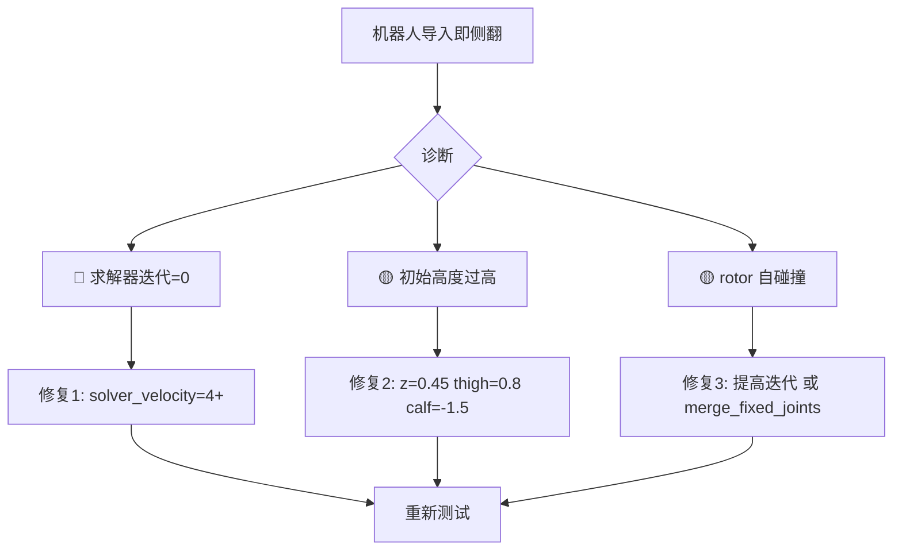

# Aliengo 导入即侧翻 — 根因分析与修复计划

## 问题描述

当前训练配置基于 `ext-force-disturbance-only` 分支的 `uniFP_aliengo` 配置，按照
`plans/real_base_only_no_arm_plan.md` 删去了 arm 相关配置。测试训练时，机器人刚导入就侧翻。

## 根因分析

经过对配置文件、URDF 模型和参考配置的全面对比分析，发现以下 **三个主要问题**：

---

### 🔴 问题 1（最可能的根因）：PhysX 求解器迭代次数过低

| 参数 | 当前值 (uniFP) | 参考值 (accaliengo) |
|------|----------------|---------------------|
| `solver_position_iteration_count` | **4** | 16 |
| `solver_velocity_iteration_count` | **0** | 8 |

**位置**: [`unifpaliengo_env_cfg.py`](source/LMP/acc/tasks/manager_based/uniFP_aliengo/unifpaliengo_env_cfg.py:282) 第 282-283 行

**影响**：
- **`solver_velocity_iteration_count=0` 是致命的** — PhysX 求解器完全不进行速度层面的约束求解
- 机器人落地后，接触力无法被正确计算，导致不对称的力分布
- 一侧腿获得过大的反弹力，另一侧不足 → 立即侧翻
- 自碰撞（rotor links）也无法被正确解算

**修复**：将求解器迭代提高到合理值：
```python
solver_position_iteration_count=8,   # 至少8，建议16
solver_velocity_iteration_count=4,   # 至少4，建议8
```

---

### 🟡 问题 2：初始姿态和高度不匹配

| 参数 | 当前值 (uniFP) | 参考值 (accaliengo) |
|------|----------------|---------------------|
| 初始高度 z | **0.6 m** | 0.45 m |
| thigh_joint | **0.5 rad** | 0.8 rad |
| calf_joint | **-1.0 rad** | -1.5 rad |

**位置**: [`unifpaliengo_env_cfg.py`](source/LMP/acc/tasks/manager_based/uniFP_aliengo/unifpaliengo_env_cfg.py:302) 第 302-321 行

**几何分析**（Aliengo 大腿 0.25m + 小腿 0.25m）：

```
当前配置 (thigh=0.5, calf=-1.0):
├─ 大腿垂直分量: 0.25 × cos(0.5) ≈ 0.219m
├─ 小腿垂直分量: 0.25 × cos(0.5) ≈ 0.219m
├─ 总腿高: ≈ 0.438m
└─ 离地间隙: 0.6 - 0.438 = 0.162m ← 机器人悬空 16cm 后自由落体！

参考配置 (thigh=0.8, calf=-1.5):
├─ 大腿垂直分量: 0.25 × cos(0.8) ≈ 0.174m
├─ 小腿垂直分量: 0.25 × cos(0.7) ≈ 0.191m
├─ 总腿高: ≈ 0.365m
└─ 离地间隙: 0.45 - 0.365 = 0.085m ← 仅 8.5cm，更稳定
```

**影响**：
- 机器人从 16cm 高处坠落，冲击力大
- 结合问题1的低求解器迭代，接触响应不稳定 → 侧翻

**修复**：使用与 accaliengo 一致的初始姿态：
```python
init_state=ArticulationCfg.InitialStateCfg(
    pos=[0.0, 0.0, 0.45],
    joint_pos={
        "FL_hip_joint": 0.1,  "FL_thigh_joint": 0.8,  "FL_calf_joint": -1.5,
        "RL_hip_joint": 0.1,  "RL_thigh_joint": 0.8,  "RL_calf_joint": -1.5,
        "FR_hip_joint": -0.1, "FR_thigh_joint": 0.8,  "FR_calf_joint": -1.5,
        "RR_hip_joint": -0.1, "RR_thigh_joint": 0.8,  "RR_calf_joint": -1.5,
    },
),
```

---

### 🟡 问题 3：`merge_fixed_joints=False` 保留了大量 rotor 碰撞体

**位置**: [`unifpaliengo_env_cfg.py`](source/LMP/acc/tasks/manager_based/uniFP_aliengo/unifpaliengo_env_cfg.py:264) 第 264 行

**URDF 结构分析** — `aliengo.urdf` 中的固定关节链接：

```
trunk
├─ (fixed) → base           [碰撞: box 0.001³]  ← 虚拟根链接
├─ (fixed) → imu_link       [碰撞: box 0.001³]  ← 在 trunk 正中心，与 trunk 重叠！
├─ (fixed) → FR_hip_rotor   [碰撞: cylinder r=0.035 h=0.02]
├─ (fixed) → FL_hip_rotor   [碰撞: cylinder r=0.035 h=0.02]
├─ (fixed) → RR_hip_rotor   [碰撞: cylinder r=0.035 h=0.02]
└─ (fixed) → RL_hip_rotor   [碰撞: cylinder r=0.035 h=0.02]

每个 hip → (fixed) → *_thigh_rotor  [碰撞: cylinder]
每个 thigh → (fixed) → *_calf_rotor [碰撞: cylinder]
每个 calf → (fixed) → *_foot        [碰撞: sphere r=0.0265]
```

总计 **17 个额外刚体**（base + imu + 12 rotor + 4 foot），全部保留为独立碰撞体。

**与自碰撞的交互**：
- `self_collision=True` + `enabled_self_collisions=True` 启用了完全自碰撞检测
- PhysX 默认禁止父子关节之间的碰撞，但**不禁止隔两个关节的碰撞**
- 例：trunk 的 hip_rotor 可能与非相邻腿的 thigh 碰撞
- 结合问题1的低求解器迭代 → 碰撞穿透无法解算 → 爆炸性力 → 侧翻

**修复建议**（二选一）：
- **方案A**：设置 `merge_fixed_joints=True`（将 rotor/imu 合并到父体，减少碰撞体数量）
  - ⚠️ 注意：这也会合并 foot 链接；需要更新足端接触传感器路径
- **方案B**：保持 `merge_fixed_joints=False`，但大幅提高求解器迭代（问题1的修复）

---

### ✅ 已排除的可能原因

| 检查项 | 结果 |
|--------|------|
| MDP 层残留 arm 代码 | **无** — `arm_joint`/`gripperMover` 搜索无结果 |
| obs/action dim 不匹配 | **正常** — policy obs=46, action=12，纯腿部 |
| 关节名称错配 | **正常** — URDF 中的 12 个关节名与配置一致 |
| 执行器覆盖遗漏 | **正常** — hips/thighs/calfs 覆盖全部 12 个关节 |
| URDF 文件选择错误 | **正常** — 使用 `aliengo_description/urdf/aliengo.urdf` 纯腿版 |

---

### ⚠️ 次要注意项

**Thigh 关节类型为 `continuous`（无位置限制）**：
- URDF 中 `FL_thigh_joint` 和 `FR_thigh_joint` 等为 `type="continuous"`
- `soft_joint_pos_limit_factor=0.9` 对无限制关节可能行为未定义
- 这本身不会导致即时翻倒，但在训练中可能影响 PD 控制器行为

## 推荐修复优先级



### 修复步骤

1. **优先修复** `solver_velocity_iteration_count` 从 0 → 至少 4（建议 8）
2. **同时修复** 初始姿态参数，使用 accaliengo 验证过的值
3. **可选** 提高 `solver_position_iteration_count` 到 8-16
4. **观察修复效果后决定** 是否需要调整 `merge_fixed_joints` 设置

## 修改文件清单

仅需修改一个文件：
- [`unifpaliengo_env_cfg.py`](source/LMP/acc/tasks/manager_based/uniFP_aliengo/unifpaliengo_env_cfg.py)

修改位置：
1. 第 282-283 行：`ArticulationRootPropertiesCfg` 中的 solver iteration 参数
2. 第 302-321 行：`InitialStateCfg` 中的 pos 和 joint_pos 参数
