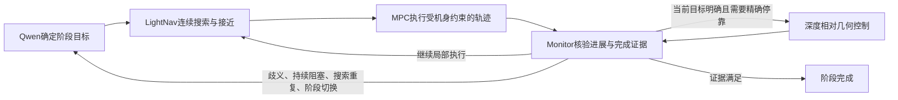

# Qwen 与 LightNav：按证据划分局部自主权

2026-09-16。将连续局部搜索、转向选择和目标接近交给LightNav；Qwen负责意图、歧义、阶段/区域选择与策略改变；几何/MPC负责身体约束，Monitor负责可核验的完成。下文保留当时实现和研究记录。

**2026-09-17修正：** 已删除Monitor自动推进/启动阶段、补写STOP语义、自动精确执行或脱离的决策路径。Qwen用显式工具选择阶段、生成原样下传指令，Monitor只反馈在线证据并核验；未证实的前序阶段不阻止Qwen切换目标，也不会因此授予完成。当前实现见[NAVIGATION_QWEN_AUTHORITY_20260917.md](NAVIGATION_QWEN_AUTHORITY_20260917.md)；下面2026-09-16的自动推进描述属于历史。

**2026-09-17后续讨论，尚未实施：** [Owner能力边界原文](discussions/LIGHTNAV_0_CAPABILITY_CHAT_20260917.md)与[模型身份及架构讨论](discussions/LIGHTNAV_0_ARCHITECTURE_DISCUSSION_20260917.md)。当前模型已确认同为官方LightNav-0；新讨论进一步提出将语义Monitor降为只读参考，以STOP/实际执行受阻回交Qwen，并评估独立局部避障。运行中的证据触发暂停和全部阶段证书结束门槛目前仍保留，不能把该讨论当作已完成改动。

## Owner批准后的实现

- Qwen生成阶段计划后，Monitor直接启动`maneuver=lightnav`，让MPC采用模型的实际轨迹；阶段切换和人工恢复也继续这一语义目标。删除Qwen常规`search_target`转角规划和`follow_target`选择工具，保留`continue_navigation`供高层继续或改变语义策略。
- 同一阶段/策略保留LightNav session；只有阶段、明确策略指令或错误身份纠正改变scope。短暂停车、几何控制和人工暂停不清空模型历史。
- 输入使用不同真实曝光帧，间隔至少0.25传感器秒；记录实际间隔，不伪造4fps历史。MPC记录实际生效的`command_applied`及对应模型帧/sequence，不能将推理数当轨迹采用数。
- 模型提示目标可见、同帧深度目标假设在2m内且缺少目标关联时，Monitor暂停取得语义/几何证据；重复检查须有至少0.4m平移或0.35rad转向的新视角。看见远处目标或短暂丢失目标本身不逐次唤醒Qwen。
- 已认证通路入口或已关联停点在1m内时，Monitor自动切换原精确几何控制。该距离仅决定控制分工，原穿越余量、停车条件和候梯净距不变。失败的精确动作在姿态未改变前不会被立即重复接管。
- 持续无进展、MPC受阻及局部重复搜索触发高层恢复。重复搜索使用共享odom：回到0.30m/30°范围，且已走2m并离开过0.8m，或累积旋转一圈且至少8传感器秒；该事件不证明目标不存在。最多3次恢复，模型stop仍只是ARRIVAL_CANDIDATE。
- 任务墙钟预算360秒，人工恢复沿用剩余预算；Qwen单次决策30秒。−80N制动、暂停问答与仅人工恢复保留。运行中有记录的失败也执行两项evaluator并保存results，再保留原进程错误退出码。

这次只运行固定Qwen `p05_force_resume`，不展开下文四条件对照或36/72轮。

实际运行已完成：106/106生效MPC采用模型轨迹，但完整成功0/1、NEEDS_USER；正确相向边界后的完整通路空间证据不足。−80N/人工恢复已执行，问答出现受力解释错误。全部结果见[新回合报告](NAVIGATION_LOCAL_AUTONOMY_20260916.md)。

## 模型支持什么

官方LightNav-0统一支持语言指令导航、开放词汇找物和视觉跟踪。发布checkpoint输入是第一视角RGB历史和语言，图像256×448、名义4fps，输出双通道指向和10×3 SE(2)航点。航点是相对于拍摄位姿的累计前向米、左向米、逆时针弧度，不是电机动作。[官方模型卡](https://huggingface.co/LightOriginsHQ/LightNav-0)、[官方仓库](https://github.com/lightorigins/LightNav-0)。

`opos`是目标指向假设，`apos`是行动方向/可行局部点；`visible`是模型可见性声明。顶层`stop`与`apos_state=stop`应分别解读，均不能证明实体身份、完整机身穿越或0.6–0.9m等待净距。SlowFast压缩整段历史，`num_history_frames=64`不是64帧的episode硬上限；reset和重连会丢失session历史。[官方协议](https://github.com/lightorigins/LightNav-0/blob/main/docs/PROTOCOL.md)。

所以，“目标当前不可见时先寻找/转向”属于它所支持的局部任务范围；这不等于它能证明搜索覆盖、目标不存在或满足本项目的最终几何精度。官方跨机器人展示也不替代A2上的验证。

## 调整前框架实际给了什么权限

`server.py.navigate()`选择参考来源，`tracking()`真正决定MPC使用哪条轨迹：

| reference_source | MPC真正执行的参考 |
| --- | --- |
| metric_goal | 程序生成目标对准、接近、终点朝向参考 |
| metric_turn | 指定方向/角度检查点的转向参考 |
| metric_advance | 指定距离直行参考 |
| lightnav | LightNav输出轨迹 |

前三类仍会调用LightNav、保存预测并提供目标指向，但不采用其轨迹。只有最后一类将其`stop`变成ARRIVAL_CANDIDATE。当前Monitor工具主要是已测目标、指定角度搜索及指定米数前进，因而实际绕开了连续局部轨迹入口。

**最新p05的直接计数：**

- LightNav响应56次，全是metric_turn；52接受、4丢弃；一个session、56张不同帧。
- MPC求解197次，全是metric_turn，**LightNav轨迹实际采用0次**。
- LightNav实际收到的语义指令是`Go through the doorway`，不是`Turn left/right`；问题不在于只给了它转向文字。
- Qwen作出4次转向动作，10次决策请求。LightNav的visible56次全false；stop=true4次，其中3次接受，但metric分支不把它作为到达。
- 推理墙钟延迟462–884ms，相邻输入拍摄仿真时间中位0.2s。循环按响应继续请求，没有独立的4fps输入节奏。新里程计显著改变仿真吞吐，后续必须重新核对实际传感器时间、输入采样和模型时间约定。

来源为`sim_20260916_131404/lightnav.jsonl`和`mpc.jsonl`。空闲telemetry中默认的reference_source=lightnav不能算成轨迹采用。**未统计旧72轮全部控制分支**，不能直接声称72轮全部绕开LightNav；同样也不能用72轮整体成败界定模型自主能力。

## 建议职责与触发条件

| 负责者 | 持续职责 | 何时需要它决定 |
| --- | --- | --- |
| Qwen | 用户意图、阶段目标、候选消歧、局部区域/下一步策略 | 新目标、语义冲突、区域/阶段切换、持续受阻或重复搜索 |
| LightNav | 给定语义目标后的连续局部搜索、方向选择、接近和视觉修正 | 整个局部执行阶段，不逐次请求Qwen指定转几度 |
| 几何/MPC | 深度占用、实际机身包络、速度/转向响应与可执行轨迹 | 每次控制更新；受阻时报告具体原因 |
| Monitor | 当前传感器证据、进展、停止、完整通过和精确停点 | 持续检查；接受模型线索后触发核验，独立决定阶段完成 |
| 人 | 人工暂停后的恢复、真正无法自动消除的意图歧义 | 已锁存的人工暂停或明确求助 |

建议事件流：

目标不可见本身不应立即升级给Qwen。先允许LightNav在有限局部执行范围内寻找；重复区域、没有实际进展或语义冲突才交回高层。保留同一语义目标的历史，按目标/阶段边界reset；不要因为每次正常转向重置。

精确几何控制用于最后的测距、朝向、完整通过和停靠，不宜一看到目标就把随后全部路径改成长程直线metric_goal。什么时候换目标/改变策略是Qwen的任务，停车几何是否满足是Monitor的任务。IMU/速度/深度状态失效仍明确停止，不把模型轨迹视为传感器状态替代。

## SysNav能借鉴什么

SysNav确实把VLM决策限制在房间级，但室内局部探索采用经典覆盖规划和TSP，并不是把室内导航交给LightNav。它用360°RGB与LiDAR，在线建立房间—视点—对象图、覆盖记录和房间连通关系。[论文§IV](https://arxiv.org/html/2603.06914v1)。

可以借鉴的是**稀疏的高层决策＋连续局部执行＋事件上报**。当前A2只有前视RGB-D、IMU、关节状态和局部地图，尚无可靠房间拓扑，宜先让Qwen在“任务阶段/可观测局部区域”层决策；不能仅改提示词就宣称具备SysNav的房间级能力。让LightNav替换局部策略是受其分层思想启发的新设计，需单独验证。

## 最小验证建议

保持同一A2、相机、共享传感器估计、MPC身体约束、预算和起点，比较当前metric微动作分工与LightNav连续局部执行。**在线不加入仿真真值**；真值只在离线评价中使用。

四类条件先分别看：

1. 目标可见：能否稳定接近并把候选停点交给Monitor。
2. 目标不可见：能否自主转向/局部搜索，是否绕回重复区域。
3. 穿越开口：路径是否实际采用、是否在机身约束下完成通过。
4. 相似干扰目标：何时出现语义冲突，Qwen能否有效消歧。

至少记录LightNav轨迹实际采用的控制时长/求解数、Qwen调用数、无进展与回访、目标误认、误停/误完成、身体净距/接触、定位误差和力交互覆盖。采样节奏与历史reset也必须记录。少量单场景结果只能验证接口和具体能力，不能建立长程房间搜索、跨场景泛化或实机有效性结论。

此前80帧异常后来在另一设备161次调用中未复现，不能作为模型固有历史上限；也不能据此宣称原CUDA根因已修复。历史记录见`NAVIGATION_YOLO.md`。
