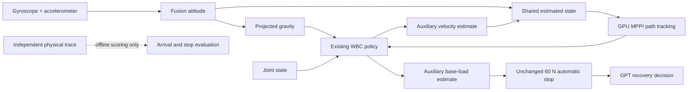

# Continuing until the planner declares completion — 2026-10-15

## Owner instruction and acceptance

The Owner asked to continue diagnosing unsuccessful attempts until GPT naturally
returns `complete`, and then independently assess whether the original task was
actually fulfilled. The earlier one-trial stopping instruction is superseded for
this work. An unsuccessful task process is preserved, evaluated and investigated;
it is not the final delivery for this request.

The action contract retains honest `needs_user` and explicit runtime errors. No
schema or prompt forces a success claim. `complete` still means GPT believes the
original task is fulfilled; independent physical success is a separate result.
No target, wall, glass or contact is deleted to manufacture completion.

The Owner subsequently chose **“Find the building exit and stop near it.”** after
the asset check: retain closed doors, approximate arrival and stop, without an
outdoor crossing. The two earlier attempts retain their original outdoor task;
they are not rescored as successes under the changed goal. Spawn, scene,
HEAD RGB camera, GPU MPPI settings, WBC weights and the 60 N stop threshold are
unchanged. There is no whole-task/GPT deadline or skill/correction count limit.
GPU3's resident model remains loaded; GPU4 serves Isaac and MPPI. Networking is
direct except for the already configured, scoped Codex proxy.

## Attempt 01: XY screen corrected, original gyro-only attitude

Evidence: `.local/outputs/campus_planner_complete_20261015_01/`.

- **NEEDS_USER**, runtime error null, no GPT completion claim.
- **14.874 m** physical travel, still inside at the east corridor end; final stop confirmed.
- **124 MPPI controls**, all actually sent; 45 navigation-model inputs and one model STOP.
- Eight observation actions. GPT reviewed the same-source target probe, confirmed
  its local observation goal, and navigated continuously. After STOP it explicitly
  kept the white panel separate from the original destination, and chose left turns.
- The last requested left 90 degree turn was not completed. Estimated load crossed
  60 N during subsequent decision waiting, and GPT requested help.
- Both primary evaluators and the raw RGB/video, exact model inputs, control,
  independent physical trace and contacts are preserved. No old success is reused.

This demonstrates that removing the incorrect XY veto allowed actual handoff and
control. It does not demonstrate a physically correct building-exit completion.

## Located input defect: accumulated gravity error

The RGB-only estimator initialized gravity once, then integrated only gyro. Its
gravity vector also supplied the WBC's projected-gravity observation. On the prior
standing failure, tilt error rose from 0.79 degrees at 30 s to **13.59 degrees** at
141.92 s. The body was nearly stationary while learned velocity and equivalent
base-load estimates drifted.

Raw gyro and the adjacent physical pose increments disagree persistently. A fixed
initial pose or a different integration quadrature does not remove this. The data
does not prove a fixed hardware gyro bias or identify the PhysX internal cause;
no empirical gyro residual was subtracted. Gait [0,1], the 32-frame history layout
and original aux scaling match the saved training configuration.

### One frozen-input comparison

Evidence: `.local/outputs/imu_gravity_correction_20261015_01/`.

The comparison uses the same 28,085 original sensor packets and a single published
Fusion parameter setting. Physical truth scores tilt only. WBC replay changes
only the gravity observation; joints, commands, gait and original previous-action
history remain fixed. Baseline aux output reproduces the recorded values exactly.

| Fixed-record measurement | Gyro only | Gyro + accelerometer |
|---|---:|---:|
| Tilt RMSE | 6.466 degrees | **0.311 degrees** |
| Final tilt error | 13.585 degrees | **0.413 degrees** |
| Peak learned horizontal equivalent load | 66.623 N | **3.978 N** |

This supports repairing the gravity observation. It does not prove improved
physical navigation, calibrated force detection or reliable translation.
A helper packaging error was fixed and its traceback retained; it caused no
simulation or model-service task and is not treated as navigation evidence.

### Production repair

`prototype/robot/proprio_odometry.py` now uses **imufusion 1.3.3** gyro/accelerometer
attitude. `IsaacA2Simulation` passes the actual nominal IMU period. Units are explicit:
rad/s → degrees/s and m/s² → g, NWU convention, without a magnetometer. Published
gain 0.5, acceleration rejection 10 degrees and rejection recovery 5 s are used;
unknown gyro range recovery is disabled explicitly. The library rejects inconsistent
acceleration rather than treating every instantaneous sample as true gravity.
These choices follow the [versioned Fusion documentation](https://github.com/xioTechnologies/Fusion/tree/v1.3.3)
and [official Python example](https://github.com/xioTechnologies/Fusion/blob/v1.3.3/Examples/Python/advanced_example.py).

One attitude supplies WBC gravity and the shared geometric/control state. Heading
and integrated WBC translation remain unbounded estimates. No depth, simulator
orientation, global map, fixed bias subtraction, controller fallback or new motion
freedom is introduced. Force scaling and threshold remain unchanged.

The repair changes the attitude input. It does not turn the auxiliary load estimate
into a calibrated collision detector or make integrated translation reliable.

The actual production class replays all 28,085 packets with final tilt error
**0.4127 degrees**. Duplicate timestamp calls leave the pose unchanged. This is
recorded-input verification, not another physical trial.

## Attempt 02: corrected sensor attitude — cancelled for goal change

Evidence: `.local/outputs/campus_planner_complete_20261015_02/`.

This task used the production attitude repair and preserved the original outdoor
goal. When the Owner selected stopping at the closed exit, the owned process was
gracefully interrupted and its partial evidence retained. It had executed 514 MPPI
controls and five observations, with zero external-force stop events. It made no
completion declaration. Raw cancellation is explicitly classified by
`OWNER_GOAL_CHANGE_CANCELLATION.json`, not counted as a completed task or a spontaneous
runtime failure. No partial result is promoted to navigation success.

## Attempt 03: near-exit goal — interrupted for a feedback repair

Evidence: `.local/outputs/campus_planner_complete_20261015_03/`.

This process used the near-exit goal and the production attitude repair. It made
83 GPT decisions, sent 100 navigation-model inputs, performed 29 observations and
actually executed 138 MPPI controls. Physical travel was 17.830 m; there were zero
estimated-load stop events. GPT did not declare completion. Both evaluators and
the complete partial video are retained.

Repeated target reviews spent long intervals rewriting the same unconfirmed goal
without motion. Main interrupted the owned process after locating and checking a
missing-history integration defect. `REPAIR_RESTART.json` records this intervention.
Raw `CancelledError` remains intact; the aggregate class is
`INTERRUPTED_FOR_FEEDBACK_REPAIR`, not a spontaneous runtime failure or completed
navigation. This partial task is never counted as a success.

### Missing history in independent GPT requests

The Codex planner starts each request independently. The coordinator supplied
executed navigation progress and observation results, but omitted earlier rejected
target handoffs and earlier planner decisions. Consequently GPT could inspect the
current mismatch without seeing its own preceding failed wording changes.
This is a real missing input; it does not prove that all repeated decisions have
the same internal cause.

Every request now receives all accepted/discarded planner proposals and compact
complete target-handoff history, including instruction, selected source region,
model pointing/STOP, review disposition and confirmation. Raw waypoint arrays and
duplicate image files are not repeated in that history. The original evidence
remains archived. These are online facts, not a semantic supervisor or new retry
limit. Accepted proposals remain distinct from executed motion. GPT retains the
choice of wording, observation, navigation, completion or help.

One actual GPT call repeated recorded decision 70 with all six JPEGs byte-for-byte
unchanged, adding the omitted 69 predecessor decisions and 39 handoffs. GPT
explicitly recognized repeated mismatched rewrites without movement and chose
`advance_observe`, 0.15 m/s for 4 s, to obtain another view. No motion was executed
in this check. This supports input delivery, not closed-loop navigation success.
Evidence: `.local/outputs/planner_handoff_memory_20261015_01/`.

A separate read-only source audit found no pointing-coordinate conversion error:
the official 48×27 grid maps `<opos_210>` to [280,45.33] in the original 768×272
image. Whole-frame resizing has no crop/letterbox offset. The model point and GPT
region really differ in that example. This does not certify either target identity.

## Attempt 04: natural GPT completion — independently scored

Evidence: `.local/outputs/campus_planner_complete_20261015_04/`.

The same E2 start, task, scene, camera, controller, WBC and force threshold were
retained. The change from attempt03 was the planner feedback history and its
system explanation. The task ran in its own tmux with GPU4 CUDA/RTX UUID matched
and GPU3's external model retained. ETA reviews did not terminate the task.

### Result

| Question | Independent result |
|---|---|
| Did GPT naturally choose `complete`? | **Yes**, decision 87; no forced completion |
| Online terminal state / runtime error | **COMPLETED / null** |
| Physical travel | **35.615 m** |
| Physical stop | **Confirmed** over the final 0.6 s |
| Genuine building-exit arrival | **UNVERIFIED**, not counted as success |
| Final location | Facing signed double doors **G**, not Entrance A |

Wall time was 3120.557 s, about 52 minutes. The complete camera video is
1175.667 s (19 minutes 35.7 seconds). The final base pose was
[3.84322, -0.94678, -1.79630] in world x/y metres and yaw radians. Final 0.6 s
peak physical planar speed was 0.000179 m/s and peak absolute yaw rate was
0.000241 rad/s. These measurements establish stopping independently of the
planner's estimated-stop reference.

### What actually moved the robot

- **87 actual GPT decisions**, all accepted. The longest took 30.581 s and was
  allowed to finish beyond the removed 30 s limit.
- **65 observation actions**: 31 turns and 34 short advances. They executed within
  their original command authority. Skill 39 returned `ANGLE_NOT_REACHED`; GPT
  continued from the returned evidence. Observation calls were not count-limited.
- **68 navigation-model inputs**, one session, one initial reset. Eighteen inputs
  were standing target probes. Seven probe STOPs and two continuous-navigation
  STOPs were preserved. No probe trajectory was executed.
- **146 GPU MPPI solves**, all actually sent, with no command mismatch. Median GPU
  solve time was 3.049 ms and median end-to-end solve time was 4.577 ms.
- The initial continuous navigation segment executed those 146 controls and
  travelled 4.828 m. A later confirmed navigation segment produced **zero controls**
  before STOP. It is not counted as successful movement or recovery.
- The later approach was mainly executed through GPT's observation actions.
  This is an overall framework completion claim, not proof that the navigation
  model autonomously completed the whole route.

The first continuous STOP was sequence 49 at capture time 126.58 s, physical pose
[16.342, -2.910, -0.301]. GPT kept the white-panel observation subgoal separate
from the original destination and chose a left 90-degree observation. The second
continuous STOP was sequence 63 at 1038.70 s, near [4.489, 0.596, -1.965]. GPT read
the zero executed-control count and requested a short advance instead of treating
STOP as arrival.

At the final target review, probe sequence 67 pointed at the same double door
chosen by GPT but also predicted STOP. GPT confirmed identity, then chose one
more observation advance at 0.10 m/s for 4 s. That action physically travelled
0.408 m, with 0.344 m net displacement, and stopped. GPT subsequently declared
completion from the visible door, paired handles, earlier exit sign and returned
stop evidence. The runtime then verified an estimated stable stop; independent
physical scoring above confirmed actual stopping.

### Feedback delivery was exercised

`analysis/planner_memory_evaluation.json` compares every actual GPT request with
the preceding online events. All 87 requests contained the complete preceding
decision and handoff histories, with matching proposals and review dispositions.
The final request contained 86 prior decisions and 18 handoffs. Standing/probe
authorization checks passed. Source-image binding, STOP-source association and
same-session continuation passed. Real time-prefix encoding was not changed.
This verifies the feedback path; one task does not establish general reliability.

### Why physical task success remains unverified

The final door is
`/Campus/Floors/F1/Scene/OfficeGlazing/Foyer_DoorLeafGlass0-1`, previously labelled G.
Its paired handles and `Foyer_Exit` mesh with `Exit.png` exist in the asset. The
exit sign was not invented by GPT. The closed leaves have static collision and
were not altered. The base stopped about 3.303 m from the door plane; this is a
description, not a new distance gate.

However, G has opaque `Foyer_InteriorBacking` behind it, the modelled floor ends
at its plane, and no exterior paving connection was confirmed. The relevant USD
metadata says `evidence=visual_estimate`. Neither the sign nor `OfficeGlazing`
alone establishes actual building use. Its genuine building-exit identity is
therefore **unresolved**. Entrance A is a different structure, 15.483 m from the
final base position. The new generic exit goal is not silently replaced by an
A-only distance test, and an unverified signed door is not promoted to success.
`physical_success` and `false_completion` are both null. See `EXIT_IDENTITY_AUDIT.md`.

### Contact and sensing limits

The non-foot contact observer recorded 217 samples above 10 N; its largest
per-body net normal signal was 511.985 N on RR_thigh at 138.985 s. Counterpart,
contact position and friction are unavailable; self-contact and force cancellation
are included. This cannot certify collision-free travel or identify a struck wall.
The learned horizontal base-load estimate peaked at 26.654 N, below the retained
60 N stop threshold. There was no automatic force stop or force-stop resume, so
those physical branches remain untested by this task.

Online inputs remained HEAD RGB, IMU and joints/WBC estimates. No depth clearance
certificate, global map or simulator pose selected an action. The attitude repair
does not calibrate the contact detector or remove translation/heading drift.

## Offline asset precondition

A read-only OpenUSD inspection found that Entrance A has four closed glass Cube
colliders and static jambs. The leaves and ancestors have no RigidBodyAPI or
animation samples; the combined stage has no UsdPhysics.Joint. There is no runtime
door actuator. The exterior paving is a real colliding surface, about 2.5 cm below
the interior floor. The eastern end glass and western far-door panes also have
static collision. This proves A is closed; it is not a full connectivity proof
that every possible exit is inaccessible.

The inspection is **offline**. It does not supply target coordinates, map or door
identity to GPT, the navigation model or MPPI, and it does not change the asset.
Standing inside a closed exit is not scored as crossing outdoors.

## Accounting, evidence and closure

| Process | Goal / classification | GPT complete | Physical task result |
|---|---|---|---|
| 01 | Original outdoor goal; controlled NEEDS_USER | No | Failed |
| 02 | Original outdoor goal; owner goal-change cancellation | No | Partial, not scored as success |
| 03 | Near-exit goal; interrupted for missing-history repair | No | Partial, not scored as success |
| 04 | Near-exit goal; natural COMPLETED | Yes | Exit identity unverified; stopped |

There were four new task processes, two completed attempts and two explicitly
classified interruptions. The original outdoor and new near-exit goals are not
pooled into one interchangeable success rate. Frozen replays, the one recorded-view
GPT call and historical short checks are excluded from navigation success.
Aggregate: `.local/outputs/planner_complete_20261015/results.json`.

Attempt04 preserves both primary evaluators, `results.json`, exact GPT/model inputs
and outputs, original JPEGs, IMU/joint streams, MPPI/final commands and independent
physical/contact traces. All five trace tails agree at 1177.140 s. The full
17635-frame, 15 fps video decoded successfully. An English **10x** review video is
117.567 s, 1536×640, 30 fps; its caption explicitly says exit identity unverified.
An initial preview-render filter error was retained and the caption was rendered
as a PNG stacked below the unchanged camera image; it was not a navigation error.

Key attempt04 artifacts:

- `navigation/episode/camera.mp4` — complete original video
- `navigation_review_10x.mp4` — accelerated English review
- `navigation/analysis/trajectory.png` and `.svg` — physical route and actual G endpoint
- `navigation/analysis/navigation_evaluation.json` and `control_evaluation.json`
- `navigation/analysis/planner_memory_evaluation.json`
- `navigation/analysis/handoff_evaluation.json`, `force_stop_evaluation.json`
- `EXIT_IDENTITY_AUDIT.md`, `VIDEO_VERIFICATION.json`, `PREVIEW_RENDER.json`

The task, evaluator and rendering processes have exited. The owned navigation
tmux sessions are gone; GPU4 is released (4 MiB idle at closure). GPU3's model
PID2454462 remains resident and listening on 127.0.0.1:8050, with its original tmux
retained. Other projects were not terminated. No training, hardware operation,
driver reset, Git commit/push or additional success-selected trial was performed.
The requested natural GPT completion and independent assessment are finished.
