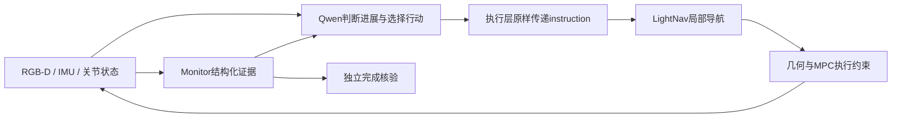

# Qwen决策权与Monitor核验分离

## 修复的问题

原房间到全开门房间的旧轮已实际出门，但Monitor缺少出口证据，自动阶段门控一直保持旧指令。之前STOP补丁还由Monitor生成纠正文本，使验证器同时承担语义决策。本次按Owner要求修正职责，并由Owner明确追加授权一轮相同路线的完整测试。

## 当前职责

| 模块 | 职责 |
|---|---|
| Qwen | 根据任务、前后RGB和估计运动判断进展，选择执行阶段，生成完整英文导航/纠正指令，选择观察、精确执行或恢复策略 |
| Monitor证据核验 | 报告已证实、未证实、候选身份矛盾；提供未满足条件与来源；按原条件认证完成，不决定下一语义动作 |
| 执行协调层 | 执行Qwen工具提议，原样传递instruction，维护目标会话、预算和事件记录 |
| LightNav | 持续局部搜索、转向、接近和视觉修正 |
| 几何/MPC | 计算米制轨迹并约束身体、障碍、停车余量及物理可行性 |



### 具体改动

- `monitorFeedback`包含`verified/unverified/contradicted`、未满足条件、候选身份审核、测量问题、实测通门状态、空间证据、RobotState和STOP来源；不生成动作指令。没有观测到完整穿越不能被表述为“确定未通过”。
- 新`select_stage`由Qwen明确指定计划中的阶段和实际英文instruction。前序未证实也可推进或返回补证；离开的未证实阶段保持`DEFERRED`，不变成`COMPLETED`。阶段选择记录`authority=qwen`及`completionGrantedBySelection=false`。
- `continue_navigation`的instruction改为必填，并原样进入控制请求和LightNav的semanticInstruction。Monitor不再把reason或模板拼入文本。同目标改写不改变scope，目标阶段切换明确改变scope。
- 初始执行、完成后的下一阶段、测量后的继续、近处精确控制和受阻脱离都等待Qwen实际工具提议。`follow_measured_target`与`recover_clearance`只请求原几何/控制能力，不放宽其约束。
- 同帧三次审核失败后，向Qwen发出`progress_reassessment`，提供完整任务、当前和上一动作图像、估计运动及失败证据。它可以换阶段、换视角、生成纠正或明确求助；执行层不再在这里自行选择求助。
- 计划工具按可核验终态分阶段：进入房间属于整机通门，走廊等路径并入所通向的终态；不机械按动词制造“走廊门”或进入后再次靠近门板的阶段。实际计划仍由Qwen生成。
- 完成核验只更新证书、不增加currentStage。全任务完成仍要求所有阶段证据成立，并在当前最终阶段满足原几何与停稳条件；先切换目标不补发旧证书，也不允许在错误最终位置完成。
- 离线evaluator按计划中的pass_doorway阶段索引映射门口，不再假设证书产生顺序等于计划顺序。实际语义对应仍须检查，不能用几何评分替代目标身份。

原`conditions`方法逐字保持，任务360秒/决策30秒/原每阶段最多3次恢复、MPC、相机、原生深度、时间编码与实体证据门槛均未改变。所有Qwen在STOP/受阻后的实际恢复动作受原预算约束。没有增加真值、目标外观模板或强制前进。

## 完整运行前的验证

TypeScript构建和Python评分源码编译通过。新证据根`.local/outputs/qwen_decision_authority_20260917_01/`，before保存任务开始时的源码，保留原有未提交工作。

1. 使用旧真实STOP的在线输入调用编译后的派发路径，截获控制动作：同目标继续逐字保留Qwen文本、scope不变、恢复0→1；选择另一阶段改变scope，旧阶段DEFERRED、新阶段ACTIVE、任务仍RUNNING，没有授予完成。
2. 两次实际实验室Pi/Qwen调用：计划输出两个pass_doorway；对旧同帧审核失败后的当前/历史图像和估计运动，Qwen选择向右30°换视角，并自行生成`Observe the right side of the corridor to find the target room entrance.`，派发的instruction和semanticInstruction均逐字一致。这个提议在CPU端截获，没有执行物理运动。

上述是接入和决策路径证据，不是新导航成功。原始结果在`analysis/compiled_dispatch_replay.json`和`qwen_probe_results.json`；模型配置为实验室Qwen FP8末尾斜杠、off、2048、直连，无鉴权。

## 唯一新完整导航

使用`hospital_room_to_open_room.json`，从原房间[12.8,3.35,.55,0°]出发，终点为此前同一右侧全开门房间；默认相机/原生深度、独立10厘米期望净距、无后拉和人工暂停。GPU0启动前无计算进程，独立tmux `guidepup-qwen-authority-20260917`。

实跑的Qwen计划与前述离线probe不同：它把完整路线合为一个pass_doorway，目标为对面右侧全开门房间。随后它实际调用`select_stage(stageIndex=0)`，原样下发：

```text
Go out of the current room, through the corridor, and enter the fully open room on the right across the hallway. Stop only when the entire robot body has entered the room.
```

因此本轮不是预先锁定的两阶段计划；不能把唯一阶段的完成证书机械映射为源房间出口。独立物理评估仍必须检查两道实际门按顺序穿越及最后停在目标房间。模型能生成新计划与真正走到目标是不同证据。

### 本轮结果：真实成功0/1，LIMIT_REACHED

任务226.159秒，实际行走2.36385米；后部包络尚差0.21710米才能清空第一道门，目标房间未进入。末态停稳，Monitor没有完成或误报完成。没有增加第二轮。

| 项目 | 实际证据 |
|---|---|
| Qwen | 9次请求；6个运动提议中5个实际下发，最后一个因3次恢复上限未执行 |
| 实际决策 | 初始整段路线指令、向右15°恢复、继续原目标，以及Qwen自行改写的走廊/右侧全开门指令 |
| 文本传递 | 5个实际动作的instruction和semanticInstruction逐字等于Qwen原文，并按各自control task ID关联到实际模型输入 |
| LightNav | 57次响应，53接受、4因控制代次变化丢弃；接受的STOP为0 |
| 会话 | 一个session，仅seq0重置；包括Qwen改写后仍保持历史 |
| MPC | 141次记录，137实际下发：125次LightNav轨迹、12次Qwen要求的米制转向；4次blocked |
| 真正完整出第一门 | false；末态后三圆边缘相对远门框−0.21710米 |
| 真正进入目标房间 | false |
| 实际停稳 | true；末0.3秒最大速度0.00316米/秒、最大yaw角速度0.00670弧度/秒 |
| Monitor | LIMIT_REACHED，阶段仍ACTIVE，完成事件0，误完成0 |


### Qwen指令确实进入模型并执行

动作1/3/4使用上述完整任务指令；动作2为Qwen提出的向右15°有界恢复，实际文本：

```text
Turn right to clear the obstacle and re-align with the path toward the open doorway on the right across the hallway.
```

动作5由Qwen实际调用continue_navigation，自行改写为：

```text
Move forward through the corridor towards the far end, angling slightly right to align with the fully open doorway on the right side of the opposite wall. Stop only when the entire robot body has entered that room.
```

该文本原样出现在seq25–56的32次实际LightNav输入。两者之间没有Monitor补写英文或按完成证据阻止语义调整。

按控制动作ID关联，五个动作分别对应seq0–10（11次，1丢弃）、11–15（5次，1丢弃）、16–19（4次，1丢弃）、20–24（5次，1丢弃）、25–56（32次，0丢弃）。不能仅凭同文instruction把早先输入算到后一个动作。所有请求的真实传感器/墙钟时间与session/reset字段保留在原始lightnav.jsonl。

Qwen最后又提出新措辞，但没有执行：先前3次恢复已经消耗，执行预算拒绝第4次恢复并终止为LIMIT_REACHED。这与Monitor自行选择下一目标不同；预算及物理约束仍然有效。

### 本轮失败来自控制约束和求解，不是重复STOP

| 仿真时刻 | 记录原因 |
|---|---|
| 13.52秒 | 当前/延迟包络初始净距约−0.252米；停车余量约−0.342米，约束拒绝 |
| 18.12秒 | 当前/延迟包络初始净距约−0.227米；停车余量约−0.321米，约束拒绝 |
| 21.74秒 | 停车约束MPC优化返回`Maximum_Iterations_Exceeded` |
| 32.58秒 | 停车约束MPC优化再次返回`Maximum_Iterations_Exceeded` |

这些负值是传感器估计地图上的控制计算，不能直接当作真实门框穿透或已确认撞墙。本次未进一步定位障碍体素来源与优化收敛原因，没有清空地图、放宽条件或重调控制器来通过任务。

进程/HTTP/记录器错误字段均为空，但**两次优化迭代上限失败必须单独保留**，不能概括成全程无错误。非足部最大净法向力0牛、超过1牛采样0；observer没有接触对象、点和摩擦，零合力不证明无接触。

### 验证到了什么，尚未覆盖什么

- 新正式回合证明实际导航/有界转向/语义改写由Qwen工具提议发起，文本真实传到模型，原恢复预算生效，缺少证据没有被记成成功。
- 本轮Qwen合为一个阶段且始终选择stage0，没有发生切换到不同阶段；“前序未核验仍可选后续阶段、旧阶段DEFERRED”的行为由编译后CPU功能回放验证，不能冒充实跑覆盖。
- 本轮没有LightNav STOP，因此没有实跑覆盖STOP后的专门纠正分支。旧STOP证据上的两个实际Pi调用和CPU回放属于接入验证，不计新导航成功。
- 本轮测量审核过程中Qwen已主动提出导航，没有耗尽三次同帧审核后才重新决策；三次耗尽路径的改动不能被描述成这次完整导航实际触发。
- Qwen判断自己“已在走廊”不等于整机已通过出口；独立物理包络仍有21.7厘米未清空。决策权修复没有证明模型的空间判断或整个导航任务已可靠。

### 离线评分的阶段映射修正

实跑产生“一阶段覆盖两门”的计划后，确认按计划序号一一映射仍不适用。在物理任务结束后，仅修正离线evaluator：pass_doorway阶段数量与门数量不相同，就不生成机械的证书对应关系，保留UNMAPPED解释。对同一物理记录重算两项评估，没有第二次导航；本轮本来就没有完成事件，因此成功/失败、路径、接触等结果不变。原评估副本、修改后评分源码及说明保存在`evaluation_before_mapping_clarification/`、`evaluator_after_run.py`和`offline_mapping_note.json`。

## 证据和收尾

- `.local/outputs/qwen_decision_authority_20260917_01/navigation/`：results、两项评估、scenario、完整Qwen请求和工具返回、视频与源快照。
- `.local/outputs/isaac_sim_20260917_015658/`：57对JPEG/NPZ、实际LightNav文本/输出、MPC、传感器、独立物理轨迹和接触。
- `analysis/navigation_evidence.json`、`analysis/NAVIGATION_REPORT.md`：按真实动作ID匹配的决策→执行→模型证据；`analysis/compiled_dispatch_replay.json`、`qwen_probe_results.json`为单独的接入验证。
- `implementation_check.json`确认原完成条件方法未改；`before/`保留任务前代码，未覆盖旧未提交工作。
- `trajectory.png`、`plot_route.py`与`navigation/episode/camera.mp4`保留本次实际运动；末态包络在图中单独画出。
- `final_resources.json`确认四个本任务服务PID及tmux均退出，GPU0无计算进程（4MiB/0%）。Codex专用代理和其他项目进程未动。

实现、这一轮测试、证据与memory收尾完成。没有追加导航、训练、硬件操作或Git提交/推送。
