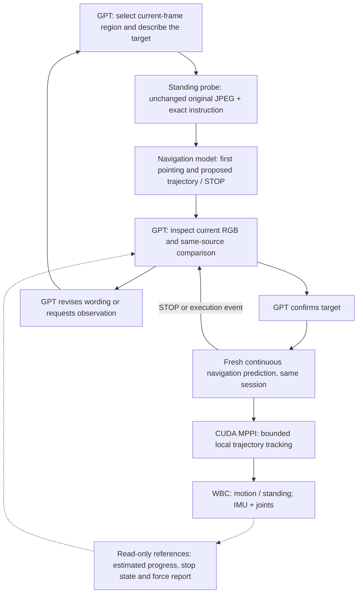

# Standing and visual target handoff — 2026-10-15

## Result

The implementation, narrow verification and **one new full task** are complete.
The task ended **NEEDS_USER**, without a runtime error or completion declaration.
It did **not** reach outdoors. Actual travel was **1.257 m**, mostly during two
observation turns, and the final physical stop was confirmed.

The full task exposed a new implementation error: the added XY freshness veto
treated drifting WBC dead reckoning as physical displacement. It rejected ten
nearly stationary decision windows before any navigation-model input or MPPI solve.
That veto was removed after the task and checked on its recorded online states.
**The corrected screen has not had another full navigation trial.**

| Full-task observation | Result |
|---|---|
| Full tasks / automatic retries | **1 / 0** |
| Planner outcome / physical success | **NEEDS_USER / false** |
| Planner completion / runtime error | **false / null** |
| Sensor duration / wall duration | **140.40 / 411.67 s** |
| GPT calls / accepted decisions | **14 / 3** |
| XY freshness discards / force-authority discard | **10 / 1** |
| Observation actions | **2 right turns: −60 and −90 degrees** |
| Actual turn angles | **−61.395 and −90.321 degrees**, both stopped |
| Target proposals / navigation-model inputs / MPPI solves | **0 / 0 / 0** |
| Automatic force-stop / actual resumption | **1 / 0** |
| Final actual peak speed in last 0.6 s | **0.00222 m/s** |
| Final actual peak yaw rate in last 0.6 s | **0.00644 rad/s** |

The trial therefore verifies standing authority and the two executed turns, but
does not validate target review, continuous navigation or outdoor completion.
There was no model STOP or MPPI refusal. No second full task was started.

The unchanged natural goal is **“Find the building exit and go outside.”** The E2
spawn, MF-R1 scene and geometry, A2 HEAD RGB-only camera, navigation weights,
MPPI settings, WBC checkpoint and 60 N force-stop threshold remain unchanged.
There is no full-task deadline, GPT thinking deadline, observation-call limit or
correction-count limit. Each observation still has its existing motion authority
and local execution deadline. No depth, target coordinates or simulator truth
are supplied to online decisions or control.

Evidence:

- Narrow checks: `.local/outputs/target_handoff_20261015_01/`
- One full task: `.local/outputs/campus_target_handoff_20261015_01/`
- Prior diagnosis: `NAVIGATION_BUILDING_EXIT_20261015.md`, including its handoff audit.

## Implemented responsibilities

GPT retains task, strategy and target-identity decisions. The coordinator sends
the selected instruction unchanged and enforces action authority. The semantic
Monitor remains read-only. Neither a bounding-box test nor the Monitor chooses a
new semantic target, advances a stage, or certifies outdoor arrival.

### Explicit standing and decision freshness

Zero command formerly could retain the WBC's force-driven gait. Decision waiting,
target probing, hold, skill settling and completion stopping now disallow that
gait. This requests standing; it does not freeze the simulated body or guarantee
no physical displacement. Existing automatic force-stop and human-brake priority
remain in force.

Before snapshotting a GPT view, the coordinator observes the existing 0.6 s
estimated stable-stop condition for at most the existing 3 s local settling window.
Failure to settle remains evidence rather than fabricated stability. Before
dispatching an action, the **current implementation** checks the source reference
and IMU rotation against the existing 3 degree observation tolerance. Confirming
a goal also checks its original probe frame. XY integration is explicitly marked
unverified reference evidence; it cannot independently veto a view. Image age is
logged; it is not a thinking deadline.

The full task used an earlier version that also vetoed a 0.10 m estimated XY
change. Its actual source snapshot is preserved separately from the post-trial fix.
The corrected rotation/reference screen does not verify physical translation,
registration, arrival or obstacle clearance. GPT compares the source and current
RGB; passing a rotation screen does not certify that the view is unchanged.

### Same-image target review

`navigate` now proposes a goal with an exact current `frame_id`, a normalized
`bbox_xyxy` and a full instruction. While standing, the navigation model receives
the **same archived original JPEG bytes and instruction**. The box is not sent as
a native point-goal feature. GPT receives a separate overlay copy containing its
green region, the model's red object point and yellow action point.

Only GPT can `confirm_navigation`, revise its proposal, request another view or
ask for help. Box overlap and `visible=true` are reference evidence, not identity
proof. Missing or boundary pointing remains uncertain. Both models can agree on
the wrong physical target; the mechanism does not remove that possibility.

Confirmation preserves the navigation session and history. It starts a fresh
normal model prediction before control; the earlier probe trajectory is never
re-timed or executed after GPT's thinking interval. A probe STOP stays STOP and
returns to GPT. It is never removed or replaced by forward motion.

The shared contract and instruction policy also expose these actions to the
existing Pi adapter. The full task uses GPT, not a new Qwen/Gemini trial.

### Low-speed observation execution found during verification

The short physical check exposed an existing interface problem. At the final
part of a turn, intended yaw commands below 0.1 rad/s entered the legacy standing
deadband. In short check 02, 285 nonzero yaw-command ticks requested a turn while
the gait was off; the left turn stopped near 25 degrees.

Explicit nonzero observation commands now retain motion authority below that
deadband. The existing angle loop aims at the requested angle and verifies its
settled error. It may correct within the original motion deadline. The original
3 degree acceptance tolerance, 0.30 rad/s maximum, acceleration limit, motion
deadline, degrees of freedom and stable-stop requirements remain unchanged.
Zero observation commands still request standing. No synthetic minimum velocity
or timeout extension was introduced.

## Narrow verification — not navigation success

### Frozen protocol / WBC check

`check_handoff.py` and `protocol_checks.json` verify proposal/probe/confirmation,
STOP preservation, stale-view rejection, non-execution of the probe path and
standing authority. A real WBC with frozen recorded sensors verifies that an
explicit 0.05 rad/s observation command retains gait, while zero waiting and a
higher-priority pause use standing. The target box is an offline fixture, not
production scene knowledge. This does not prove physical collision stopping.

### Two actual GPT calls on an old failed image

`planner_replay_results.json` uses the exact old seq43 JPEG and instruction.
The first annotation-only call selected the right glass region
`[0.749, 0.335, 0.897, 0.574]`. The second saw the recorded model object point on
the left and refused to confirm. It requested a right 35 degree observation turn.
No new navigation-model inference or physical command occurred. This demonstrates
that the review can expose this recorded object mismatch, not new arrival success.
The first annotation-only request is narrower than ordinary online task planning.

### Short physical standing and signed-turn checks

All four attempts remain in the evidence directory. No failed attempt is hidden.

| Short attempt | Left +30 degrees | Right −30 degrees | Result |
|---|---:|---:|---|
| 01 | +24.687 degrees | −29.681 degrees | Left failed |
| 02 | +24.687 degrees | Not run | Left failed; low-command gait deadband identified |
| 03 | +25.801 degrees | −30.123 degrees | Left failed; near-tolerance stopping undershot |
| 04 | **+27.647 degrees** | **−32.205 degrees** | Both within original 3 degrees and physically stopped |

The fourth attempt's 10 s initial stand moved 1.14 cm net. After settling, held
view displacement was 1.23 cm and yaw change −1.58 degrees. Both post-turn stands
passed. The left observation turn itself translated 20.77 cm net despite zero
translation command; this remains a WBC/plant limitation. A turn is not guaranteed
to pivot at a fixed point. Offline actual motion scored these checks; it did not
select their commands.

## Full-task diagnosis and post-trial correction

The single full task used GPU3's resident model and GPU4 for Isaac/MPPI, with
renderer/CUDA UUID agreement recorded. GPU4 was released on normal task shutdown.
The existing proxy remained scoped to the Codex child; other task traffic was direct.

### Standing succeeded, but the XY screen blocked progress

Every waiting interval had zero commands, zero walking ticks and zero force-driven
walking ticks. Nevertheless, uncorrected velocity integration accumulated apparent
translation. Independent offline scoring found all ten XY-rejected decision windows
below both original physical motion thresholds.

| Recorded GPT decision | Estimated XY change | Actual XY change | Outcome |
|---|---:|---:|---|
| 1, 2.18–10.12 s | 24.99 cm | **1.25 cm** | Wrongly discarded by XY veto |
| 10, 91.64–99.64 s | 62.30 cm | **0.76 cm** | Wrongly discarded by XY veto |

This was a coordinator error, not evidence that GPT or the navigation model
misidentified an exit in this run. No target instruction reached the navigation
model. MPPI was not asked to optimize anything. Both actual observation turns
reached the original angular tolerance, but translated approximately **0.211 m**
and **0.629 m** net while turning; fixed-position pivoting remains unverified.

After this diagnosis, `handoff.py` removed only the unverified XY veto. XY estimates
remain visible with `translation_validity=unverified_uncorrected_dead_reckoning`.
IMU rotation, lost tracking, epoch mismatch and generation/force priority remain
checked. The same-image GPT review and fresh post-confirmation prediction remain.
No odometry correction, smaller XY constant, hidden truth or controller fallback
was added.

`POST_TRIAL_FIX_CHECK.json` replays the ten recorded online state pairs through the
actual changed function. They are no longer rejected for integrated XY drift.
A changed yaw, lost tracking and different epoch are still rejected. This added
zero model calls and zero physical tasks. It does not establish future navigation
success or translation observability. The earlier protocol check's synthetic XY
rejection is historical, not a requirement retained by the corrected implementation.

### Automatic force stop

At 125.28 s, the learned horizontal force estimate crossed the inherited 60 N
threshold for two consecutive samples. The trigger was **60.016 N**, vector
**[51.935, 30.078, 0.042] N**, direction **30.08 degrees toward the robot's left
from forward**. That direction is the estimated force on the body, not a contact
location. The interruption was during GPT waiting; one in-flight proposal was
discarded for changed force authority. Maximum learned horizontal estimate was
**66.613 N**. GPT saw persistent estimated load and chose `needs_user`; it had
permission to resume but did not request motion.

All post-latch command and walking ticks stayed zero. Post-latch actual travel was
2.64 cm and net displacement 2.61 cm. Because the body was already standing, this
does **not** validate emergency stopping of a moving robot. Automatic force-stop
resumption was not exercised. No force or manual pause was injected. All recorded
non-foot per-body net normal forces were zero. This does not substantiate a real
60 N obstacle load; the cause and standing-state calibration of the learned
estimate remain unresolved. Foot forces, friction, self-contact and observer
coverage limitations prevent a collision-free certificate.

### Saved deliverables

The two primary evaluations are `navigation/analysis/navigation_evaluation.json`
and `control_evaluation.json`. Root `results.json` separates physical success,
GPT declaration, runtime error and post-trial recorded-input verification.
`handoff_evaluation.json` marks the target handoff **NOT_EXERCISED**, rather than
counting an empty set of probes as a pass. Zero input-associated sessions/resets
means no inference inputs, not evidence of a lost or reloaded resident service.

- `navigation/episode/camera.mp4`: **2107 frames**, 768×272, 15 fps,
  **140.467 s**, complete decode verified.
- `navigation/analysis/trajectory.png` / `.svg`: independent physical trajectory
  against the previous natural-goal task; USD background is offline only.
- `navigation/analysis/freshness_diagnosis.png` / `.svg` and `.json` / `.csv`:
  estimated versus physical motion for each decision window.
- `navigation/analysis/force_timeline.png` / `.svg`: estimate, commands and independent
  contact record; the quantities are not interchangeable.
- Full original RGB, raw IMU/joint and state estimates, exact GPT inputs/output,
  two chronological observation contact sheets, physical/contact logs and original
  full-task source snapshot. Navigation-model/MPPI logs are empty because no call ran.
- `post_trial_fix_source/`: changed source after the completed task, kept separately.
- `ATTEMPT_ACCOUNTING.json`, `VIDEO_VERIFICATION.json` and `CLOSURE.json`.

All five trace tails match at **141.92 s**. No missing final samples were filled in.
The command's exit code 2 represents the controlled `NEEDS_USER` outcome; runtime
error remains null. One GPT call took **32.759 s**, with no 30 s cutoff.

This is a joint implementation, not an isolated causal estimate of each change.
It does not add depth-based obstacle avoidance. RGB MPPI remains bounded trajectory
tracking without metric obstacle checking. The learned applied-base-force estimate
is not interchangeable with per-body net contact force. The contact observer lacks
counterpart identity, contact points and friction; it cannot certify collision-free
navigation or attribute every force to an obstacle.

No additional full trial, training, hardware operation, driver reset or Git commit
was performed. All task-owned simulation, video and planner processes are closed.
The Owner's resident GPU3 navigation model, PID2454462 / port8050, remains loaded.
