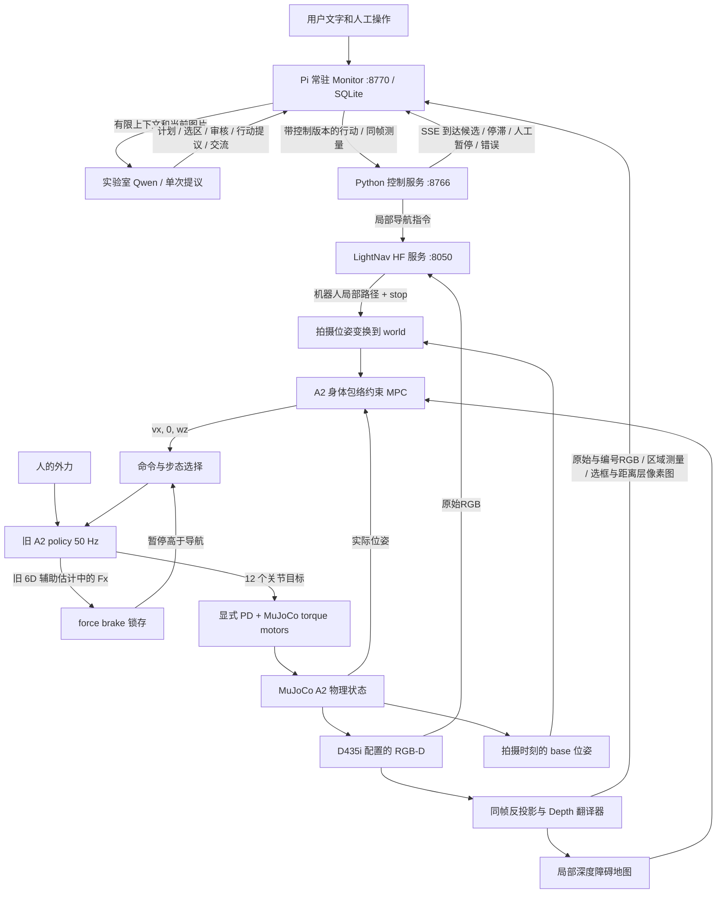

# A2 导航与力交互原型

## Current default: A2 HEAD RGB + Codex + CUDA MPPI

The simplified deployment entry is now `bash prototype/run.sh --output <NEW_DIRECTORY>`.
See [the RGB-only navigation README](navigation/README.md) for configuration and verified limits.
The new default task is **middle elevator E2 → main-lobby glass entrance A**, stopping
approximately nearby on the indoor side. The initial heading faces along the corridor
toward the lobby. The earlier task toward the elevator remains historical.

Current data flow: **Codex GPT-6.1 Sol / medium / fast → navigation model → GPU MPPI tracking → existing A2 WBC**.
A2 HEAD provides RGB only. IMU and joint observations feed the existing auxiliary velocity
estimate and short-horizon dead reckoning. There is no online depth map or geometric avoidance.
Approximate visual arrival replaces precise docking. Progress evidence is read-only.
The navigation model stays loaded on GPU3. The first full RGB-only trial ended NEEDS_USER: 13.39 m travelled, still 13.29 m from Entrance A.
There is no successful arrival claim; details are in the navigation README.

Everything below describes earlier RGB-D experiments and their historical entrypoints.
`prototype/isaac/run_experiment.py` is retained for explicit RGB-D reproduction;
the old Pi stack can be addressed through `prototype/stack.py` rather than the default `run.sh`.

## Previous default scene and task: campus MF-R1

当前 Isaac 测试入口默认加载学校的一层＋三层 USD；默认任务为“一层起点走到中间2号电梯门前，朝门停下”。使用GPU7，导航端口8768。场景准备、实际加载验证和任务入口见 [Isaac说明](isaac/README.md) 与 [校园场景接入报告](NAVIGATION_CAMPUS_MF_R1_20261015.md)。

本次已验证A2原生RTX画面、RGB-D、里程计和局部地图，未运行完整导航。几何只用于初始化和离线评分；在线导航不接收场景坐标或拓扑。跨楼层乘梯未接入。

## 早期原型说明（历史参考）

跨机器接续见 [迁移说明](MIGRATION.md)：代码分支、Drive 附件、环境重建和两个待完成测试的可移植入口。

最新通用框架修正、原始上下文回放及运行限制见 [NAVIGATION_FRAMEWORK.md](NAVIGATION_FRAMEWORK.md)；此前YOLO与两模型72轮对照见 [NAVIGATION_YOLO.md](NAVIGATION_YOLO.md)。Owner已将本任务的当前分配更换为物理GPU0；CUDA/EGL按硬件UUID绑定。

本工作树把旧 A2 checkpoint、LightNav 和 Pi 接成三个独立进程。Pi 内的常驻 Monitor 维护任务与阶段，按事件调度 Qwen；Python 控制服务保留运动和人工制动权。范围是仿真中的多阶段语义导航、已有 force brake 和文字/图像交互，不引入人体位置估计、乘梯控制或新版扶手 wrench estimator。

## 工作树与运行入口

```bash
cd /home/baoquanc/workspace/ForceControl-lightnav
```

分支 `codex/a2-lightnav-prototype` 从 `4605004`（2026-05-25，A2_v2）创建。所选训练 run 为 `2026-05-23_14-25-38_A2_base_only_v2/model_59999.pt`，直接复用该 run 的 `mujoco_exported/policy.pt` 和 `policy.json`。训练时有未提交的 v2 配置，故这里不把 May 25 提交宣称为完全相同的干净训练版本。原 `ForceControl` 工作树保留原状。

`.local` 指向 `/mnt/ssd1/baoquanc/forcecontrol-lightnav`，保存环境、第三方仓库、模型、资源和运行产物。代码和运行说明在本工作树。可以打开 `ForceControl-lightnav.code-workspace` 作为编辑器工作区；任务所有 shell 命令也应以本目录为工作目录。

软件/模型下载按 Owner 要求使用服务器网络直连。安装/下载入口显式清除代理环境，并设置 `NO_PROXY=*`；在 tmux 中运行也不继承旧代理。Owner 2026-09-15 指定本次迁移附件上传 Google Drive 使用代理。

当前使用实验室 Qwen、D435i 配置的 RGB-D、Depth 翻译器和考虑 A2 身体/摆腿范围的 MPC。
LightNav 继续接收原始 RGB；几何来自相机深度与机器人位姿，不读取场景目标坐标。
工具和控制实现不等于已保证无碰撞或可靠完成，实际结果见 [RGB-D与MPC运行结果](RGBD_MPC_RESULTS.md) 和 [历史运行记录](RUN_STATUS.md)。
增强Depth翻译器的三模型18回合同帧对照已完成，见[Qwen/Gemini/DeepSeek测距对照](pi/DEPTH_COMPARISON.md)。
当前是 navigation v2：单段决策 buffer、规划/实际轨迹分开、按阶段保留 LightNav 历史，以及显式候梯站位。实现见[常驻 Monitor 设计](pi/MONITOR_DESIGN.md)、[运行接口](pi/README.md)，新版证据见[NAVIGATION_V2](NAVIGATION_V2.md)；[上一版多阶段实测](MONITOR_TEST.md)保留原始正负结果。
新增[房间→电梯大厅](sim/scenes/ROOM_ELEVATOR.md)：`prototype/run.sh reset --scene room_elevator --record-contacts`，起点看不到电梯，固定指令为“出门走到电梯门口”。
Monitor 自动绑定实际观察帧，分开执行选区、测量审核和行动；暂停保留阶段，失效提议不能提交。候梯站位由公开的 `prototype/pi/navigation-contract.json` 定义，原始用户需求仍完整保留。门框/目标像素语义仍需实际核验，协议 `COMPLETED` 不代替独立结果。
此前的[完整 Qwen 测试](QWEN_FULL_TEST.md)和[单阶段电梯测试](ELEVATOR_TEST.md)保留为旧实现记录；CLI 未指定 scene 时仍默认 ProcTHOR。

## 连接关系



Qwen 不输出关节目标或实时速度。Monitor 拥有任务进度，Python 拥有运动状态，MPC 输出候选速度，旧 policy 保留受力后的顺应行为。模型调用期间控制服务照常处理 force brake；Monitor 失联时控制服务独立停下其导航。

## 本机启动

本机环境已安装时，使用统一入口：

```bash
prototype/run.sh build
prototype/run.sh up
prototype/run.sh reset --scene room_elevator --record-contacts
prototype/run.sh run "出门走到电梯门口" --max-recoveries 3 --timeout-s 360
# 或启动常驻 HTTP Monitor（与 run/chat 三选一）：
prototype/run.sh monitor --port 8770
# 持续交互：
prototype/run.sh chat
# 查看服务与任务状态，或停止本原型的两个本机服务：
prototype/run.sh status
prototype/run.sh reset  # 结束当前 Pi 任务后，重置仿真到起点，保留 LightNav 模型服务
# 为碰撞诊断记录每个 5 ms 物理步的接触；只写本地日志，不送给模型：
prototype/run.sh reset --record-contacts
prototype/run.sh down
```

`run`、`chat` 和 `monitor` 自动启动未运行的服务，复用已就绪的 LightNav 与仿真。同一仿真只允许一个有效 Monitor。它们不会解除人工暂停；需要人工在 Pi 中 `/resume`，或调用 Monitor 的 `/resume`。`build` 只编译本地 Pi，不下载模型。LightNav 和仿真分别运行在 `forcecontrol-lightnav-serve` 和 `forcecontrol-lightnav-sim` 两个 tmux session。

LightNav 的安装、下载与状态详见 [lightnav/README.md](lightnav/README.md)。Pi 已安装；新机器重建可运行各自 `setup.sh`。MuJoCo 环境只读复用本机 conda 的 torch 2.10.0 和 mujoco 3.6.0，新包安装到 `.local/envs/sim`。

```bash
bash prototype/sim/setup.sh
LIGHTNAV_GPU=0 bash prototype/lightnav/serve.sh
```

另一个终端启动仿真，再用 Pi 连接：

```bash
bash prototype/sim/run.sh
prototype/pi/run.sh status
prototype/pi/run.sh scene /tmp/a2-scene.jpg
prototype/pi/run.sh navigate "Turn right and go through the open doorway."
prototype/pi/run.sh pause
prototype/pi/run.sh resume
```

仿真默认使用 LightNav 仓库附带的 ProcTHOR 室内场景。`--scene flat` 是旧 policy 与受力行为的简化场景。`http://127.0.0.1:8766/` 展示 RGB 和状态；`/docs` 展示 HTTP API。服务绑定的是运行机器的 loopback，远程查看时需使用该机器的端口转发。

纯仿真的力交互可以从人工速度命令开始，再通过物理引擎施力：

```bash
curl -sS http://127.0.0.1:8766/command -H 'Content-Type: application/json' -d '{"vx":0.3}'
curl -sS http://127.0.0.1:8766/force -H 'Content-Type: application/json' -d '{"xyz":[-80,0,0],"duration_s":2}'
prototype/pi/run.sh status
prototype/pi/run.sh resume
```

这里的 `xyz` 是随 base yaw 旋转的局部力，单位 N；`duration_s` 使用仿真时间。`/command` 和 `/force` 没有注册为 Pi 模型工具。停止服务用对应前台的 Ctrl+C；后台仿真使用 `tmux send-keys -t forcecontrol-lightnav-sim C-c`。

Pi 的 `status/scene/navigate/pause/resume` 是不依赖 LLM 的人工 CLI；`chat` 和 `ask` 调用真实模型。当前使用 [实验室 Qwen 服务](qwen/README.md)：`http://vic.precognition.team:8888/v1`，精确模型 ID `Qwen3.6-35B-A3B-FP8/`，末尾斜杠保留，无需鉴权。本机不再安装或下载 Qwen。

```bash
prototype/pi/run.sh chat
```

示例：“出门走到电梯门口。” 仿真通过 `/events` 推送控制状态变化；Monitor 保留原目标和阶段，在到达候选或停滞事件后调度 Qwen。当前证据见 [Monitor 实测](MONITOR_TEST.md)。

## 控制权限与时间

| 层 | 当前接口与时间基准 |
| --- | --- |
| 旧 policy | 46 × 32，term-major 历史；12 维关节动作；辅助输出 6 维原始训练尺度 |
| MuJoCo | 0.005 s physics step，4 substeps；每个物理步计算 PD torque |
| 步态 | walking 2 Hz；暂停时 command 为零、gait 为 `[0,1]`，仍执行 policy 和 PD |
| 相机 | D435i 配置的同帧 RGB-D 640×360、10 Hz目标采样；保存内外参、base位姿和时间 |
| MPC | CasADi/IPOPT，15×0.15秒预测，目标10 Hz更新；上限0.3 m/s、0.6 rad/s；实测耗时另记 |
| LightNav | 异步一帧一请求；60 s 显式请求超时；真实延迟写入状态 |
| Pi Monitor | 事件驱动、按决策目的开放提议工具、SQLite 持久化；普通遥测不调用模型，人工 resume 独立 |

MPC 使用真实仿真位姿选取路径进度。当前还输入实际平面速度和上一求解的仿真耗时，先预测旧指令在求解期间的运动，再用一阶速度响应预测新指令；这项近似来自本轮暴露的执行延迟与停车尾迹，不能代替所有受力工况的验证。受力后速度不匹配不会被错误积分成“已经走过”的里程，也不会因时间过去自动跳过路径点。MPC 仍可能提高候选速度以追踪路径，需通过闭环受力运行测量，不能由架构图宣称影响已消除。

制动保留旧辅助输出 `Fx <= -0.6` 连续 2 个 policy tick、`requested_vx >= 0.2` 的条件；不把 `-0.6` 当成牛顿值。人工速度模式仍要求 `abs(requested_wz) <= 0.10`。导航模式允许前进转弯时触发：实际 −80 N 运行发现 MPC 会在拉力作用下增大转向，旧遥控的角速度条件因此漏掉制动，导航接入已移除这项角速度限制。下一次 policy observation 使用停车 command/gait。仿真中的外力通过 `/force` 真实施加到 base，制动后也不自动删去外力。这仍是前进时的后拉制动，不宣称已实现原地转向或各方向的统一受力停止。

相对遥控实现，导航侧新增 `HUMAN_PAUSED` 锁存：导航输出变成零、转弯或新任务，都不能解锁。此状态的导航请求返回 409。只有人工 `/resume` 可恢复，先清空旧指令和路径、进入 IDLE，Monitor 取得新观察后再决定如何继续原阶段。暂停时也阻止 standing force-walking 再次接管。原实机 Select/L2+B/A 流程不在本 Python 仿真中伪装复现；后续硬件适配要保留部署 session 的 v2 控制权限。

LightNav `stop`只进入`ARRIVAL_CANDIDATE`。模型确认当前像素与任务的语义关联后，Monitor依据本阶段执行记录和最新实测几何/停止状态自动推进；不再让模型额外提议阶段完成。Python接受当前控制版本的完成请求后记录`LOCAL_DONE`，所有阶段通过后Monitor记录任务`COMPLETED`。目标语义仍依赖模型，接触与真实几何另做离线核验。

`scene` 返回原始RGB、6×3编号RGB、各格独立距离带及有效比例；`measure_region(frame_id,bbox_px)`
测量缓存同帧原图像素ROI，并返回全图选框、实际裁剪图及距离层像素对应图。统一距离是base原点到表面的水平距离，
不是机身前缘净空或路线剩余距离。未知深度不等于空旷，前景/背景不混成一个平均表面。
不为“到物体前”暗设默认1米，目标语义仍由Qwen负责。详见 [深度接口](camera/DEPTH_TRANSLATOR.md)。

历史RGB-only任务中Qwen无法可靠核验数值距离。新增深度工具后，计算与帧关联已实际核对，
但初次只读运行中Qwen将地板误选为家具；裁剪图版本随后正确描述了所测墙面，却没有完成
“选择家具”的请求。测得数值正确不代表所选目标语义正确，不能把工具接通当成可靠完成判定。

MPC采用三个圆覆盖A2已观测身体与摆腿包络，深度点经同帧完整位姿变换、地面筛选、
4cm体素化后保留4m局部已观测障碍。预测轨迹受包络约束，完整局部点云参与结果核验。
求解失败报告mpc_blocked并停车，不使用旧无障碍控制器。地图只记录已观测占用，不是
已验证自由空间；当前平地与静态场景假设见 [控制说明](control/README.md)。
`--record-contacts` 每5ms记录真实接触，仅离线评价，不向控制器提供场景几何或接触标签。

当前RGB-D由MuJoCo理想渲染提供，不模拟D435i的纹理缺失、反光和真实测距误差。
实机需使用已标定且正确对齐的RGB-D与里程计；没有引入人体跟踪或新policy训练。

导航期间，连续 8 个仿真秒的平面位移未达到 0.10 m、偏航变化也未达到 0.20 rad，会进入 `PAUSED`，原因为 `no_progress`。它触发任务层重新观察和局部恢复；不修改旧 policy 或 force brake 阈值。每次 LightNav 回复另存于该次仿真的 `lightnav.jsonl`，记录拍摄位姿、时间、原始路径和 stop，便于区分模型行为与控制执行。

## 相机与验证顺序

默认使用 [D435i profile](camera/README.md)：RGB640×360、69°×42.2726°、10Hz仿真采样，
相对base位置[0.30,0,0.10]m、下俯5°。深度与RGB来自相同光学网格，配置有效光轴范围
0.2–8m；这是仿真处理范围，不是实机精度声明。旧头部RGB与广角profile保留历史配置，
当前RGB-D服务仅提供已配置深度的D435i选项。

本机实现和验证进度：

1. **旧 policy + MuJoCo**：站立、前进、外力顺应、力估计与制动锁存；已完成一次功能演示。
2. **LightNav + A2 RGB + MPC**：已用真实模型轨迹完成穿门、接近家具，记录真实位姿、路径拍摄时间、延迟和速度。
3. **受力与导航共存**：完整任务中已施力并记录速度偏差、制动与人工恢复。导航前进时的转弯不再取消制动资格；原地转向仍是未覆盖项。
4. **Pi + 实验室 Qwen**：持续任务与工具链已运行；历史深度辅助版本发生过一次局部纠正。当前已接入编号RGB-D和同帧区域测距；真实探针暴露了错误目标选区，不能把测量工具或HTTP完成标记当作任务客观成功。
5. **Isaac Lab 对照**：若 MuJoCo 动态行为与已训练环境有实质差异，再用同一任务 HTTP 契约接 Isaac Lab 的真实 RGB 和 base pose。当前没有修改 Isaac Lab 训练代码，也未运行 Isaac Lab 原型。

LightNav 官方处理器按 checkpoint 的 4 Hz `frame_id` 构造视频时间信息，WS 不传真实采集时间给模型。客户端已保存真实时间用于坐标对齐；若 HF 实际推理明显慢于 4 Hz，模型历史的时间间隔仍需单独处理。这与实际位姿驱动的 MPC 是两个问题。第一条轨迹可证明连接，不能证明实时导航质量。

## 代码依据

- [LightNav 官方仓库与 MuJoCo 示例](https://github.com/lightorigins/LightNav-0)：模型服务、SE(2) 路径、MPC、室内资源。
- [MuJoCo stepping](https://mujoco.readthedocs.io/en/stable/programming/simulation.html)：每个 physics step 写 torque/外力再推进；本原型不将关节位置直接写入 motor control。
- [Pi 脚手架](pi/README.md)：模型配置、工具和人工 CLI。
- 实机机制来源：Owner 提供的部署任务 `codex://threads/01a060af-54de-72f2-89e5-7ae9e4d2b66d`。这里只引用机制，不声明 Python 仿真等于实机验证。

最新随机起点/恢复压力实验及LightNav80帧复放见[导航压力报告](NAVIGATION_STRESS.md)。
