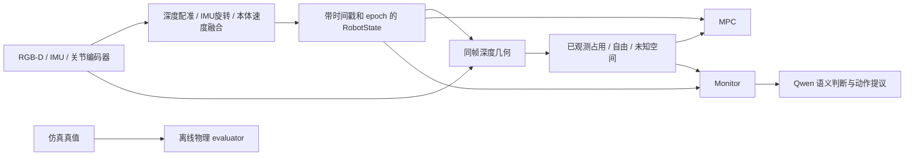

# 传感器状态接口

2026-09-16。在线导航只接收 RGB-D、IMU、关节编码器与它们产生的估计状态。MuJoCo 的基座位置、姿态、速度、场景几何及接触真值不进入这个接口。

## 数据流

`prototype/robot` 中的状态和估计器不导入 MuJoCo；仿真 adapter 在 `sim/a2.py`。传感器数据只通过 `sensordata` 的陀螺仪、加速度计和关节位置/速度通道生成。没有把 `framequat`、`framelinvel` 或带噪声的真值包装成里程计。

## RobotState

| 字段 | 含义 |
| --- | --- |
| `stamp_s` | 传感器共同时间轴上的采样时间，秒；不是 HTTP 返回时间 |
| `epoch` | 本次估计器坐标系身份；重置产生新的身份，旧目标、地图和轨迹不能跨 epoch 使用 |
| `frame_id` / `child_frame_id` | `odom` / `base_link` |
| `odom_from_base` | 估计的 4×4 刚体变换；odom 的水平面由初始静止 IMU 重力确定，位置和偏航原点为局部任意原点 |
| `pose_odom` | 从该变换导出的平面 `[x,y,yaw]`，用于局部几何和 MPC |
| `twist_base` | 估计 `[vx,vy,vz,wx,wy,wz]`，机身坐标，m/s、rad/s |
| `planar_twist` | 由同一 SE3 和 twist 投影到偏航水平面的速度及偏航角速度 |
| `tracking` | `initializing`、`tracking` 或 `lost` |
| `source` / `quality` | 估计方法、深度有效比例、约束方向等实际输出；`velocity_estimated=false` 不能证明停车 |

这是**估计值**，不是无误差的位置。没有填写未经标定的协方差，也不把 Open3D information matrix 当作统计协方差。

当前方法为 `depth_imu_proprioception`：IMU静止重力初始化、每个原始陀螺样本积分旋转，旧A2策略从传感器历史预测的机身速度提供平移先验；按checkpoint训练尺度将`aux[:3]/2`解码为m/s。深度点到平面配准只修正可观测法向的平移，弱约束方向保留本体速度预测。Open3D 0.19用于点云与法向计算，旧RGB-D hybrid路径已移除。

`quality`保存深度约束秩、法向特征值、未被深度约束的方向、对应点数和点到平面残差；不再用旧information矩阵满秩宣称视觉可靠。`velocity_estimated=true`说明产生了融合速度估计，不表示所有方向均直接可观测。失去深度重叠会锁存 `lost`；没有真值、指令积分或自动跳帧续跑替代。它不是经过实机验证的VIO/SLAM，弱约束方向仍可能积累漂移。[修复及配对证据](NAVIGATION_REPAIRS_20260916.md)。

## 同帧几何和控制

`DepthFrame(frame_id, state, rgb, depth_z_m, intrinsics, camera_to_base, valid_range_m)` 保存曝光时对应的完整 `RobotState`。深度几何通过**固定标定外参**与这个状态变换到 odom。目标表面、LightNav 路径、动作轨迹和 MPC 初态都引用这同一份状态；不再分别从仿真抽取位置和速度。

深度必须是指定 optical frame 的轴向 Z。RGB 像素网格、深度、内参必须对应同一校正坐标系；仅做深度到彩色的像素对齐不等于已重新计算彩色 optical Z，具体要求见 [深度接口](camera/DEPTH_TRANSLATOR.md)。相机到机身及 IMU 到机身的外参必须来自实际标定，不能复制仿真机身世界变换。

局部地图从深度拟合支撑平面，不再假定世界 z=0 是地面。终点形成占用体素，射线到终点之前形成已观测自由体素，未覆盖处保持未知。MPC继续使用原4cm障碍体素、机身三圆包络及净距条件；不把无障碍点等同于有通行证明。完成核验额外检查地面支撑和机身高度体积（支撑面上6cm至基座上25cm），当前假设为局部平地。

`POST /spatial_evidence` 接收 `{epoch,stamp_s,points_odom,footprint_poses_odom}`，返回各点/完整机身体积的 `free` / `occupied` / `unknown`，以及地图时间、坐标系和来源帧。地图以完成的传感器快照发布，查询不会读取更新到一半的网格。

## 与离线真值隔离

在线 `/status`、`/scene`、`/events`、`/motion` 和深度测量只发布 `robot_state` / odom。`telemetry.jsonl` 保存同样的在线信息；adapter的`sensors.jsonl`保存每个原始200Hz传感器包和解码速度预测，`estimator_initialization.json`保存实际静止IMU初始化与初始速度预测，供精确回放。

`sim/truth.py` 独立写 `ground_truth.jsonl`，保存世界位姿、真实速度及实验施力。两个 evaluator 按时间戳在离线阶段连接这份记录；不拿 odom 与场景 XML 直接比较，更不会把离线记录返回 Qwen。接触记录仍为离线诊断。仿真 plant 的初始化、渲染、动力学和施力当然仍使用仿真状态，它们不是导航观测。

## 实机接入边界

实机提供同一 `SensorPacket` 和校准 RGB-D 输入即可使用这套状态合同；低层策略历史也使用编码器、陀螺仪及估计重力。尚未连接 D435i/A2 硬件驱动或发送硬件指令。实机仍需完成外参、时间同步、静止初始化、IMU 偏置/漂移与弱纹理条件下的估计质量验证。当前仿真图像/IMU为理想传感器，不构成实机精度或可靠性证明。
