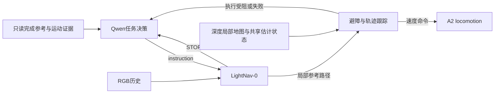

# LightNav-0身份、语义控制与外部避障

状态：讨论与事实核对；没有实施新架构、安装组件或启动导航。Owner原始讨论已原样保存为[另一份文件](LIGHTNAV_0_CAPABILITY_CHAT_20260917.md)，其内部建议不等于当前执行授权。

## 1. 是同一公开模型

当前使用的就是官方`LightOriginsHQ/LightNav-0`，基于`Qwen/Qwen3-VL-4B-Instruct`，使用RVQ动作解码器生成10个`[forward, lateral, yaw]`平面航点。官方[模型卡](https://huggingface.co/LightOriginsHQ/LightNav-0)及[论文v2](https://arxiv.org/html/2608.30935v2)描述与本地模型一致。

本地证据链：

1. `prototype/lightnav/download_model.sh`明确下载`LightOriginsHQ/LightNav-0`。
2. `environment.sh`将模型目录固定为`.local/models/LightNav-0`，`serve.sh`使用该目录、官方HF后端和`vln`模式。
3. 该目录README声明同一模型及4B基底，config为Qwen3VLForConditionalGeneration，动作包为三层RVQ、10步航点。
4. 最近真实回合`qwen_decision_authority_20260917_01/navigation/lightnav.log`明确记录从该目录加载、4fps/10步/SlowFast配置、Qwen3VL架构，并实际完成推理。

任务层Qwen3.6-35B-A3B-FP8是另一个负责对话和任务决策的模型；LightNav内部的Qwen3-VL基底是导航模型的一部分。两者角色不同，不影响本次LightNav模型身份一致的结论。

## 2. 可以移除阶段监督型Monitor，保留只读参考

我赞成让LightNav持续执行语义导航，让Qwen在需要重新解释任务时介入。LightNav已经具有指令跟随、目标搜索和跟踪能力；论文也把它定义为RGB历史到局部轨迹的统一导航策略，而不是要求外部VLM逐步指定每个转弯。[论文](https://arxiv.org/html/2608.30935v2)

### 建议的运行职责

- **Qwen**：发布完整目标或自主选择子目标；在模型停止或执行异常时决定继续、改指令、找新视角、换目标或结束。
- **LightNav**：在当前语义目标下连续观察和导航。
- **只读证据提供器**：提供当前图像、估计运动、实际执行命令、局部空间/目标测量以及不确定性。它不暂停导航要求认证阶段、不改目标、不禁止Qwen推进，也不要求所有预设阶段证书成立才能结束运行。
- **执行协调层**：传递指令、维护会话和预算、转交执行事件；同目标纠正保留历史。
- **离线evaluator**：在仿真结束后独立评价真实通门、目标房间、停稳和接触，区分Qwen宣称完成与独立验证成功。评分不能反过来控制这次运行。

当前实现还没有达到这一精简程度。上一轮修复已经给Qwen显式`select_stage`和原文指令权限，但`task-monitor.ts`仍有2米/1米证据触发暂停，以及所有阶段证书成立才能结束任务的条件。若采用本方案，应把这些运行中的语义门控撤出，保留其可用测量作为参考，把严格实验评分放在线外。

对“出房间到右侧全开门房间”，可以先给LightNav完整语义目标，无需程序强制拆成“出门证明通过→走廊证明通过→进门证明通过”。Qwen仍可因歧义或实际进展自主拆分子目标。

### STOP应是正常返回事件，但不能是唯一事件

官方协议中`stop`只表示模型预测了全零轨迹，并不证明物理任务已经完成。[协议](https://github.com/lightorigins/LightNav-0/blob/main/docs/PROTOCOL.md)

正常流程可以是`Qwen → LightNav连续执行 → STOP → Qwen`。但至少还需要执行层上报“持续不可执行/无实际进展”与错误。最近真实回合恰好有**0次LightNav STOP、4次MPC blocked**；当前服务在执行暂停时不再发新模型请求，若Qwen只等STOP，就无法恢复这一状态。这个异常入口来自已经发生的运行问题，不承担语义阶段监督。

Qwen收到事件时，应同时看到当前RGB、上一动作起点图、估计运动及控制结果。例如“模型仍建议前进，但此次指令没有执行”，让它自己决定怎么办；不能把模型预测路程写成已走路程。

## 3. 外部局部避障应承担主动轨迹修正

端到端的是模型输入到航点；整套机器人仍有航点到控制的接口。官方部署栈明确是模型→航点跟踪MPC→速度→机器人适配器，论文结论也把高频反应式避障/轨迹修正作为未来方向。作者没有指定Nav2 MPPI为官方推荐算法。[部署栈](https://github.com/lightorigins/LightNav-0/blob/main/robot_deploy/README.md)、[论文结论](https://arxiv.org/html/2608.30935v2#S7)

### 当前已经有避障约束

附件中“给原MPC增加obstacle cost/硬约束”的方案，与我们已经实现的一部分相同。当前`prototype/control/mpc.py`使用深度体素、三圆机身包络、延迟预测和停车余量，具有障碍代价及硬约束。它已经超出官方demo的纯航点跟踪器；官方demo文档明确列出其没有地图或碰撞响应。[官方demo限制](https://github.com/lightorigins/LightNav-0/blob/main/mujoco_demo/README.md#known-limits)

本项目最新4次blocked包括两次起始净距/停车余量拒绝，以及两次Maximum_Iterations_Exceeded。这不足以证明“缺一个避障算法”是唯一原因；输入地图把当前机身判为不可行时，新规划器也可能同样拒绝。体素来源、状态与时间对齐、停车响应仍需按实际失败定位。

### 更合理的控制接口

LightNav航点作为**允许局部偏离的参考路径和前进意图**；局部规划器使用同一传感器状态、深度局部地图和机身包络，生成能绕过局部障碍的速度或短程可执行轨迹。它可以绕桌边、减速和修正轨迹，但不会自行把目标换成另一扇门。局部无解时返回执行事件给Qwen。

**MPPI是值得优先评估的候选，不是已验证修复。** Nav2 MPPI本身就是带避障的预测局部控制器，能对采样轨迹计算路径和障碍代价，也支持机身footprint。它可以承担当前CasADi MPC的局部规划/速度输出角色；不宜简单叠在原来的复杂MPC前面，让两个控制器重复优化并产生新的拒绝点。[Nav2 MPPI官方说明](https://github.com/ros-navigation/navigation2/tree/main/nav2_mppi_controller)、[配置文档](https://docs.nav2.org/jazzy/configuration_and_development/configuration_guide/controller_plugins/mppi_controller/configuring_mppic/)

接入Nav2需要ROS2的Path、TF、里程计和局部代价地图适配。可以只采用局部控制器及所需地图组件，不把语义任务交给另一个行为树。它仍然是局部方法，不能保证绕过超出局部视野/规划范围的大障碍，也不会修好错误地图。运动自由度先与当前A2已用接口保持一致，不能因为算法支持横移就直接当成实机能力。

### 两种Monitor要分清

语义阶段Monitor可以退出运行控制。Nav2 Collision Monitor则是传感器驱动的速度限制/停止组件，不理解“出门、走廊、进入房间”，也不应负责阶段推进。它主要提供快速限速/停止，不会为机器人寻找绕行路线。[Collision Monitor官方说明](https://docs.nav2.org/rolling/configuration_and_development/configuration_guide/core_servers/collision_monitor/configuring_collision_monitor_node/)

附件中的“无论如何都不能撞”表述过强。该软件没有硬实时安全认证；感知盲区、延迟和实际停步仍影响结果。它可以作为独立的速度约束层，但不能被当作绝无碰撞的保证。

## 讨论结论

倾向于采用**Qwen任务决策＋LightNav连续导航＋独立局部避障/跟踪**，把原语义Monitor缩为只读证据提供器。正常交还由STOP触发，实际执行受阻另行上报。实验成功由离线评分独立说明。

后续实现宜先完成语义控制链精简，再以相同输入/机身/地图条件比较局部控制器；避免同时改变任务监督、地图和控制器后失去归因。当前仅归档和讨论，生产导航代码与实验成绩保持原状态。
