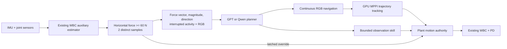

# Learned base-force brake

> Historical protocol for the first trial. The owner subsequently corrected the
> recovery authority: automatic external-force STOP is planner-recoverable;
> explicit human brake remains human-only. Current behavior is documented in
> [FORCE_STOP.md](FORCE_STOP.md). The old trial evidence remains unchanged.

## Authority and signal

The default RGB executor enables a plant-owned force brake before recording or
stepping. Every 50 Hz WBC step checks the last distinct auxiliary estimate before
building command/gait inputs. No scene geometry, simulator force, contact sensor
or physical pose enters this check.

The pinned WBC returns six auxiliary values. The first three are scaled linear
velocity. Values 3:6 are scaled equivalent applied-base forces. The pinned
`policy.json` declares `base_force_scale: 0.01`; dividing by this scale gives the
estimated Newton vector in the base yaw frame (+x forward, +y left, +z up).
This yaw frame follows the training target and is not a full roll/pitch body frame.

The historical human brake required estimated backward x force at least 60 N for
two consecutive 50 Hz samples, while commanded forward velocity was at least
0.2 m/s. The new brake keeps the same force level and sample persistence, but
checks horizontal vector magnitude, independent of movement type or command.
It therefore covers turning skills, navigation, short forward observations,
waiting for a planner and semantic stopping. Vertical force is reported but is
not part of this planar brake. There is no torque channel or moment threshold.

Once latched, the plant sets locomotion to zero, clears force-driven walking,
resets gait phase and runs the existing WBC/PD with stationary gait inputs.
This is the historical pause path, not a physics freeze or a perfect-stop claim.
The gate has priority over both MPPI and explicit observation twists.

The latch survives a falling force estimate. It has historical **human-only**
resume authority; no GPT/Pi action can release it. This batch simulation entry
reports the condition and ends after bounded stop observation; it exposes no
automatic resume or new hardware command interface.

## Interruption and planner report

The coordinator invalidates the active reference/control generation, interrupts a
skill with `INTERRUPTED_FORCE_BRAKE`, and captures its partial image sequence.
An in-flight navigation result cannot revive the path. A planner response issued
before the interruption is logged and discarded; a fresh `FORCE_BRAKE` request
reports the trigger and the interrupted instruction/skill, current sensor
references, current RGB and recent observation sheets.

The planner reports the condition through `needs_user`. Other proposals are logged
as denied by the latch; they never execute. The online status ends as
`FORCE_BRAKED`, independently of arrival. Stop observation uses the unchanged
velocity/yaw thresholds and 0.6 s stable window, with a local 10 s observation
limit while keeping the latch active until the planner report finishes.
The normal 30 s decision deadline and recovery/skill budgets remain.

## Evidence and limitations

`execution.jsonl` preserves requested and effective commands, preempted control ID,
pause/walking/gait state, raw auxiliary output, its input sensor time and force
brake state. `sensors.jsonl` records force estimates alongside the raw IMU/joints;
the 200 Hz packet log repeats the current 50 Hz estimate and labels its actual
input time. `events.jsonl` preserves trigger, interruption and actual planner input
and response. Exact planner images and full model requests remain archived.

This estimator was trained against **applied base force commands**, not contact
locations or obstacle identities. A wall/leg contact can affect its inputs, but
obstacle-contact sensitivity, recall and force calibration have not been measured.
The vector is force **on** the robot; its direction is not a known contact side.
No separate safety or collision guarantee follows from staying below threshold.

Replaying the preceding failed task through the exact WBC reproduced its recorded
auxiliary velocity with zero error. Its peak horizontal force estimate was only
50.586 N, below the inherited 60 N threshold. This mechanism would not have
triggered on that frozen record. Threshold/authority boundary checks are synthetic
interface checks, not physical braking or new navigation successes.

Source contract: `prototype/isaac/client.py`, `prototype/robot/force_brake.py`,
`prototype/sim/server.py:631`, `.local/assets/a2-old/policy.json`, and
`.local/assets/a2-old/training-origin/params/env.yaml` prediction targets.
New evidence: `.local/outputs/campus_force_stop_20261015_01/`.
