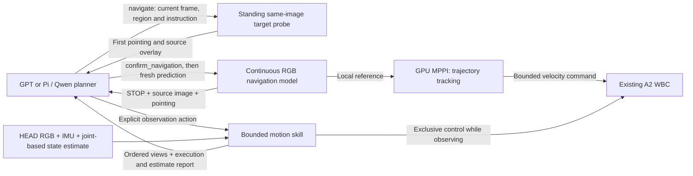

# Planner-controlled observation skills

The top-level planner can request short robot actions to obtain the views it needs.
The runtime executes one request, collects RGB evidence, and returns to the planner.
No semantic observer selects a direction, advances a stage, rewrites an instruction,
or declares the requested destination reached.



The two command sources are mutually exclusive. During a skill, navigation-model
inference and MPPI tracking are suspended. The skill is an explicit planner action,
not a backup controller for failed navigation. Forward/yaw freedoms and existing
0.40 m/s² / 0.80 rad/s² command acceleration limits are retained. No reverse or
lateral velocity is introduced. These RGB-only skills have **no geometric collision
checking**. The navigation MPPI configuration and WBC policy are unchanged.

All skills are subordinate to the plant-owned [external-force stop](FORCE_STOP.md).
An active skill ends with `INTERRUPTED_EXTERNAL_FORCE` and returns its partial views
and executed-command counts. Its requested angle/duration is not claimed complete.
The stop also disables force-driven walking. The planner may explicitly resume
navigation or moving/turning observations; hold retains the stop. Human brake
remains separately human-owned. There is no automatic restart on falling force;
zero command alone is not used as proof of stopping.

## Actions

| Skill | Parameters | Execution |
|---|---|---|
| `turn_observe` | Signed `angle_deg`, magnitude 10–180°; **positive left, negative right** | Zero forward command; IMU-estimated relative yaw feedback; maximum yaw command 0.30 rad/s |
| `advance_observe` | `speed_m_s` 0.10–0.20; `duration_s` 0.5–4.0 | Straight low-speed command with ramp-in/ramp-out; no claimed exact travel distance |
| `hold_observe` | `duration_s` 0.5–4.0 | Zero command while collecting views; physical stillness is not assumed |

`duration_s` includes ramp-in; ramp-out and bounded stop observation are additional.
Turns have a finite timeout derived from requested angle / 0.15 rad/s + 4 seconds,
not an assumed successful angle. All skills observe estimated stopping for up to
3 seconds; stable means the existing velocity thresholds hold for 0.6 seconds.
`ANGLE_NOT_REACHED` and `STOP_NOT_CONFIRMED` return explicit evidence to the planner.
Their result is neither a runtime fallback nor proof of physical success.

Explicit nonzero observation commands keep motion authority even below the WBC's
legacy 0.1 rad/s standing deadband. Zero holding and settling commands disable
force-driven gait. Turns aim at the requested angle and verify settled error;
correction is allowed only within the original motion deadline and 3 degree
acceptance tolerance. Physical pivoting and zero displacement are not guaranteed.
See the [standing and target-handoff report](../NAVIGATION_TARGET_HANDOFF_20261015.md).

Observation calls and correction cycles have no count limit. Their counters remain
in the planner input as execution history, without restricting the next choice.
There is no full-task time budget or local GPT decision-time deadline. Individual
skills retain the angle, speed, duration and settling bounds above.

## Evidence

HEAD RGB remains captured at 15 Hz. Each skill selects samples every 0.5 seconds
of actual sensor time, plus its end frame. All source images remain in `episode/rgb`.
At most 12 uniformly selected chronological samples form a labelled contact sheet;
the last two sheets are supplied to the next planner alongside current RGB and
the original source image for any navigation-model pointing.

This is **not a calibrated panoramic stitch or a metric map**. Labels contain real
sensor times and separately identified IMU/WBC-estimated yaw/displacement. No fake
frames, depth, scene geometry or simulator pose enters the online path. The model
retains its session/history on resumption; it receives no inference frames during
the observation. Its nominal frame-time encoding is unchanged; the real gap is logged.

Each `episode/observation_skills/skill_NNN/` contains the exact request, all selected
frame references, result and contact sheet. `execution.jsonl` identifies every tick
as `mppi`, `observation_skill` with `skill_id`, `external_force_stop`, or `zero_hold`. Command integrals are
labelled as commands, not odometry. Physical travel, angle and contact are assessed
later from independent simulation logs only.

## GPT and Pi / Qwen bindings

`planner-contract.json` and `planner-system.txt` are shared by both providers.
GPT keeps the existing Codex CLI transport, login, model and scoped proxy. Its
structured decision is dispatched by the runtime; it has no coding/shell tools.
Pi exposes each action as a real named tool with the same parameter schema. The
new `rgb-planner.ts` adapter reuses `PiDecision` and the existing lab `.env`; it
proposes an action without executing it. Python validates all parameters again.
No Qwen profile or default planner configuration is overwritten.

Default GPT task:

```bash
bash prototype/run.sh --sim-gpu 4 --output .local/outputs/NEW_RUN
```

Select Pi / the configured lab Qwen explicitly:

```bash
bash prototype/run.sh --config prototype/navigation/qwen-config.json \
  --sim-gpu 4 --output .local/outputs/NEW_QWEN_RUN
```

Both backends fail explicitly on runtime/model/schema errors. The sole full task
requested for this change uses the default GPT backend. Interface-only model probes
or offline checks are not navigation successes.
