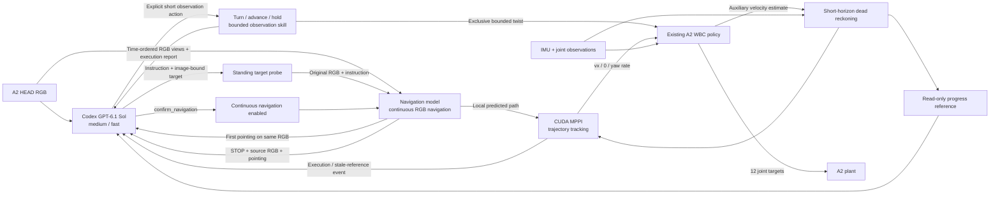

# Simplified A2 RGB navigation

## Responsibility and data flow



The planner chooses intent, instructions, strategy changes and semantic completion.
There are no semantic stage certificates or automatic stage advancement. The coordinator
passes the planner's complete instruction unchanged and preserves the same navigation
session on continuation, including instruction changes. It does not append a correction.
Each proposed goal first receives the standing target-handoff review below. Once GPT
confirms it, navigation remains local and continuous until STOP or an execution problem.
Each independent planner request includes all accepted/discarded decisions and compact
complete target-handoff history. Rejected wording changes remain visible even when no
motion followed. These records report evidence; they impose no repeat limit or next action.

The planner can now request `turn_observe`, `advance_observe` and `hold_observe`
to obtain missing views. Execution returns chronological RGB contact sheets,
actual command counts and separately labelled estimated motion/stop outcomes.
The skills are explicit actions with bounded individual duration and no call-count limit; during
them the navigation model and MPPI tracking are suspended. They add no geometric
obstacle certificate. GPT and an explicitly selected Pi/Qwen backend share the
same action contract and runtime. See [observation skills](OBSERVATION_SKILLS.md).

The plant applies a higher-priority [learned external-force STOP](FORCE_STOP.md)
to both navigation and skills, including decision waiting. Horizontal equivalent
force at least 60 N for two distinct WBC samples latches the historical pause path:
zero locomotion, force-driven walking off and stationary gait inputs. The planner
receives the estimated force vector/direction and interrupted activity. It can
release this automatic stop by confirming reviewed navigation, or choosing turn or advance; hold keeps
the stop active. The separate human brake still requires a human. This is a learned load response, not calibrated
obstacle-contact detection or geometric avoidance.

## Standing and visual target handoff

Waiting for GPT, probing a target, holding, completing and settling an observation
disable force-driven walking. Explicit motion commands retain their existing speed,
angle and acceleration bounds. This is ordinary planner-resumable standing authority;
it does not release a human brake or stop physics/sensor time.

Explicit nonzero observation commands also authorize gait below the legacy 0.1
command deadband. A small requested turn must not become a standing instruction
while its angle controller is still active. Gait switches to standing when the
accepted command reaches zero. The turn angle loop includes the final settling
result and may correct within its original deadline; no speed or angle bound is raised.

`navigate` supplies the current `frame_id` and a normalized `bbox_xyxy`, as well as
the full English instruction. The coordinator sends that exact original JPEG and
instruction to the navigation model while standing. It supplies GPT an annotated
copy showing its selected box and the model's first pointing. Box overlap is read-only
evidence; GPT chooses `confirm_navigation`, a revised proposal or an observation.
The box is not sent as a native navigation-model point-goal input.

Confirmation starts fresh continuous inference in the same session. The probe path
is never re-timed or executed after GPT's thinking interval. A probe STOP stays STOP.
Per-control logs retain the actual normal navigation-model sequence that supplied
their reference, so probe and executed predictions can be distinguished.

Decision/probe screening checks the state reference and IMU rotation: a change over
the existing 3 degree observation tolerance requests a fresh decision. Uncorrected
WBC velocity integration cannot verify translation while standing; its XY change
is reported as unverified reference evidence and cannot independently veto a view.
GPT compares source and current RGB. Passing this screen does not certify unchanged
position, scene identity or clearance. Image age is logged without a thinking-time
deadline. The existing 0.6 s stable-stop observation and bounded 3 s skill settling
remain local execution checks, not task or GPT budgets.

The [standing/target-handoff trial](../NAVIGATION_TARGET_HANDOFF_20261015.md) exposed
and removed an earlier XY veto: it rejected 10 nearly stationary decision windows.
That full task ended `NEEDS_USER` before any target probe. The correction has narrow
recorded-input verification only; no second full task was started.

## Instruction policy and STOP decisions

The GPT planner and the existing Pi `PiDecision` explicitly load the same English
[instruction policy](../pi/prompts/lightnav-instruction-rules.txt). The policy follows
the official LightNav Prompt Guide: prefer a direct action, a clear visual target and
one primary identifying cue; use robot-relative directions, or a salient relational
anchor when needed. Optional stopping requirements remain valid. It does not force
every turn into a separate planner action or change the user's destination.

For a STOP decision the planner receives labelled action-start RGB, the **exact RGB
that produced the model output**, and current RGB. The model's `pointing`, boundary
flags, original tokens, predicted waypoints, source frame and sensor timestamps are
preserved. Points refer to the source image, never silently to the current image.
STOP and `visible=true` remain predictions, not proof of arrival or target identity.

`navigation_progress` reports per-action MPPI controls actually sent, nonzero WBC
command ticks, and separately labelled estimated travel/displacement/yaw. Earlier
attempt summaries retain their instructions and outcomes. Commands are not physical
movement, and drifting proprioceptive odometry cannot certify metric arrival.
These observations are read-only: GPT chooses the next instruction or completion;
the coordinator forwards that instruction unchanged with the existing session/history.

Pi currently uses explicit `models.complete` requests and does not automatically load
skills. Sharing the policy therefore needs no coding-agent shell or new Agent wrapper.
The default GPT transport keeps the existing Codex login, exact model, medium/fast
settings. Observation calls and correction cycles have no count limit, and GPT
has no local decision-time deadline. The RGB camera, controller and
nominal navigation-frame time representation are unchanged. Details and verification:
[planner instruction update](../NAVIGATION_PLANNER_INSTRUCTIONS_20261015.md).

The requested completion convention is approximate visual arrival, followed by a stop.
It does not require a precise distance, target-relative pose, or complete-door-crossing
certificate. Model STOP alone is still not task completion. The planner claim and
estimated stopped state are separate fields; independent physical success is not
manufactured from either and remains null until evaluated against the selected task.
Old experiment outcomes are not rescored under the new convention.

## Sensors and state

- A2 HEAD simulation profile: **768 × 272**, **132° horizontal FOV**, 15 Hz;
  base-frame position **[0.3381, 0.0336, 0.0525] m**, zero nominal pitch.
- The existing mount is retained. FOV / raster originate in the earlier simulation
  setup, not a verified hardware intrinsic/distortion calibration or camera stream API.
- Only RGB is rendered/exposed in this mode. No D435, RTX distance annotator, hidden
  depth image, monocular depth model, depth map, or ground-truth pose supplies navigation.
- The WBC consumes IMU and joint observations. Its existing auxiliary output supplies
  body velocity (`aux[:3] / 2`). Fusion 1.3.3 continuously combines gyro and accelerometer
  for attitude; that same attitude supplies WBC projected gravity and the shared state.
  Gyro rad/s is converted to degrees/s, acceleration m/s² to g, with NWU convention.
  The actual sensor period comes from the plant metadata; duplicate timestamps do not
  integrate again. Published gain 0.5, acceleration rejection 10 degrees and recovery
  timeout 5 s are used. No magnetometer is supplied and no unknown gyro range is invented.
  See the [versioned Fusion documentation](https://github.com/xioTechnologies/Fusion/tree/v1.3.3).
  Heading and WBC-velocity integration still drift. This is not RGB visual odometry,
  global localization, a stationary-velocity correction or a new force calibration.
- Simulator pose/twist and PhysX contact observations are written separately for later
  offline analysis. Online planning does not read those files or use them as corrections.

## GPU MPPI and speed

`control/gpu_tracking.py` uses **pytorch-mppi 0.9.1**, PyTorch CUDA and a CUDA graph.
The library owns candidate sampling, dynamics rollouts, costs and weighted optimization.
This replaces Nav2's CPU optimizer in the new RGB path; it is not a CUDA switch for Nav2.

The explicit mode is **trajectory tracking without geometric obstacle checking**.
The navigation model reasons about obstacles from RGB. MPPI does not pass an empty
obstacle map to a depth controller or claim unknown space is free. No metric body
clearance or collision guarantee is provided by this RGB-only stack.

Configuration: [rgb_tracking.json](../control/rgb_tracking.json).

| Setting | Value |
|---|---:|
| Forward command ceiling | **0.50 m/s** (previously 0.30) |
| Yaw-rate ceiling | **0.60 rad/s** (unchanged) |
| Commanded lateral / reverse motion | None |
| Linear / yaw acceleration limits | 0.40 m/s² / 0.80 rad/s² (unchanged) |
| Control period / prediction | 0.10 s / 24 steps |
| Candidate count | 512 |

MPPI optimizes bounded acceleration actions and integrates them into bounded velocity
commands within every candidate. The final weighted acceleration sequence is rolled
out by that same dynamics function; the first resulting velocity is the actual command.
There is no additional command smoothing after acceptance. All candidate costs and
the accepted controls, predicted states, CUDA timing and device UUID are recorded.

0.50 m/s is a new, **unvalidated navigation setting** within the archived WBC training
command range [-1.2, 1.2] m/s. Training coverage is not demonstrated hardware behavior.
The previous stop-clearance model is calibrated only to 0.30 m/s; its empirical margin
is not reinterpreted or extended. Tracking retains the prior 0.15 s nominal response
time as an approximation, not a validated fast stopping/clearance model.

Increasing a speed ceiling does not ensure higher actual walking speed. Short paths,
turns, model decisions, WBC behavior and inference latency still matter.

## Codex backend

The backend invokes the installed Codex CLI with the existing ChatGPT login:
`gpt-6.1-sol`, reasoning `medium`, service tier `fast`. It uses per-call overrides,
an empty temporary working directory, strict config validation and structured JSON.
The separately authorized Astra trial uses `--config prototype/navigation/astra-config.json`:
`gpt-6-astra`, `medium`, explicit `service_tier=default` and `--disable fast_mode` on
every call. The profile changes model and processing tier together. It adds no
motion authority or prompt-specific target knowledge. Actual CLI arguments and the
Fast setting are archived; the CLI JSON does not expose the server billing tier.
Coding, shell, connectors, browser and subagent features are disabled. A proposal
containing execution tools or runtime/config diagnostics fails explicitly.

No Qwen/Gemini profile or global Codex setting is overwritten. Codex calls use the
existing local Codex proxy **only in their child process**. It does not enable a global
proxy. Dependencies, model service and asset downloads use the server's direct network.
Per-decision archives contain the exact text, images, CLI request, event stream,
response, usage and timing. There is no GPT decision-time, observation-count,
correction-count or whole-task time limit. Task shutdown still cancels its owned
pending CLI process. No alternate planner/controller is selected
on failure. The released navigation model still receives its original nominal 4 fps
time representation; actual exposure/request times are recorded, not silently repaired.

Official references: [Codex SDK](https://learn.chatgpt.com/docs/codex-sdk),
[Codex Fast mode](https://learn.chatgpt.com/docs/agent-configuration/speed),
[model](https://developers.openai.com/api/docs/models/gpt-6.1-sol),
[PyTorch MPPI](https://github.com/UM-ARM-Lab/pytorch_mppi).

## Entry and selected default task

The Owner selected **middle elevator E2 as the start** in [task.json](task.json).
The spawn is [12.51, -2.45, 0.55] m with yaw 180°, facing along the corridor toward the lobby.
Those coordinates initialize the plant only. The current online goal is
**“Find the building exit and stop near it.”** The Owner chose to retain the closed
door after the asset inspection. Crossing outdoors is no longer required; no exact
stopping distance is imposed. Earlier indoor/outdoor tasks retain their original
criteria. No target coordinates or operator floor plan go online.
The first-floor landmark images are human task-design references derived from actual USD
geometry. Empty task coordinates/goals still fail before starting the plant.

```bash
# Install only the new GPU optimizer dependency through a direct mirror:
env -u HTTP_PROXY -u HTTPS_PROXY -u ALL_PROXY -u http_proxy -u https_proxy -u all_proxy \
  NO_PROXY='*' no_proxy='*' PIP_CONFIG_FILE=/dev/null \
  .local/envs/sim/bin/python -m pip install --proxy '' \
  --index-url https://pypi.tuna.tsinghua.edu.cn/simple -r prototype/navigation/requirements.txt

# Stationary view/IMU/WBC/CUDA-controller bringup. This is NOT a navigation task.
bash prototype/run.sh --preview-only --spawn 0 2 0.55 -20 --sim-gpu 7 \
  --output .local/outputs/head_preview_NEW

# Selected route, when a complete navigation run is requested:
bash prototype/run.sh --sim-gpu 4 --output .local/outputs/rgb_navigation_NEW
```

Use an independent tmux session for persistent work. The launcher refuses a busy
physical GPU; it never terminates foreign jobs. CUDA UUID and the active RTX index
are checked against the requested physical card. The externally owned navigation
model on GPU3 / port8050 is reused and is never unloaded by this entry.

The new path writes RGB/video, raw sensor estimates, full model input/output, MPPI
costs and controls. Contact logs contain per-body net normal forces, not counterpart
collider identity/contact points/friction; self-contact and cancellation remain limitations.
The first full RGB-only trial and its limits are recorded below. No hardware motion was tested.

## First selected-route trial — 2026-10-15

Evidence: `.local/outputs/campus_rgb_e2_to_entrance_20261015_01/`.
Configuration and component evidence: `.local/outputs/campus_reframe_20261015_01/`.
Only **one full navigation trial** was run; stationary previews and reference renders are separate.

| Observation | Result |
|---|---|
| Online outcome | **NEEDS_USER**, no completion declaration, no runtime error |
| Independent physical arrival | **Not reached**: stopped at the main-lobby approach, 13.29 m from Entrance A |
| Recorded physical travel | **13.39 m** |
| Physical stop | Confirmed in the last available 0.6 s of physical records |
| Command ceiling / measured peak speed | **0.50 / 0.575 m/s**, simulation only |
| Native navigation-model input / STOP | 112 accepted inputs / 4 STOP responses |
| MPPI solves / distinct controls actually sent | **298 / 298**, no controller rejection |
| GPU / total solve median | **3.05 / 4.58 ms**, 512 candidates × 24 steps |
| Recovery 1 | 7 executed MPPI controls, approximately **6.1 cm** physical travel |
| Recovery 2 / 3 | No nonzero execution commands; the model immediately returned STOP |
| Navigation history | One session, one initial reset; text changes retained history |
| Non-foot net contact-force peak | **1266.9 N on FR_thigh**, near the lobby turn |

The first model STOP was exposed at 36.68 s simulation time, with its source frame
still 13.56 m from the entrance. The planner correctly recognized remaining lobby
floor and issued complete corrective instructions to continue to the same entrance.
Those exact strings reached the navigation model without a session reset. The model
stopped three more times. No depth-map or MPPI clearance refusal caused this ending.
The model's internal STOP cause is unresolved; contact or input-history timing effects
have not been isolated by this joint camera/planner/controller change.

Actual recovery motion is evaluated from the independent physical trace, not from
an instruction or predicted path. Model output `visible=true` did not establish arrival.
The read-only progress reference neither advanced a stage nor rewrote any instruction.
The planner kept its own decision authority and requested help after three recoveries.

The contact observer reports per-body net normal force and lacks counterpart identity,
points and friction. The FR_thigh signal cannot alone identify a particular column,
wall or self-contact. This trial is **not collision-free validation** of RGB avoidance.

The original launcher terminated the plant immediately after its close acknowledgement,
leaving **0.205 s of final physical trace and 0.035 s of contact trace unwritten**. Raw
files are preserved without fabricated samples. The reported physical endpoint/stop
uses the actual available trace; it is labelled separately from online termination.
A subsequent source fix flushes offline logs before close acknowledgement and waits for
graceful Kit exit. A stationary-only close check verifies that fix, without a second
navigation trial. The raw trial's `estimated_stable_stop=false` means its completion-only
stop confirmation was never entered. It does not mean the robot was moving; future
unrequested completion-stop checks report null, while instantaneous/physical stop stay separate.

The historical strict RGB-D evaluators do not match this approximate RGB task. The new
output therefore contains separate **navigation_evaluation.json** (physical endpoint/stop)
and **control_evaluation.json** (execution, model history, contact and errors), plus root
`results.json`. It includes the full camera video, RGB frames, raw sensors, decisions,
model responses, CUDA candidates/controls and offline physical/contact evidence.
No old task or offline prediction is counted as new success. No second full trial,
training, robot hardware operation or driver reset was performed. All task services
were closed; the Owner's GPU3 navigation model remains loaded.

## Full trial after the instruction update — 2026-10-15

One additional authorized run used the shared instruction rules and richer STOP
evidence. Physical arrival remained **0/1**: 48.137 m travelled to a different door at
the west corridor end, 34.762 m from A. The second recovery actually executed 442
controls and 27.002 m, but GPT confused that observation goal with the original task
and declared completion. Final status was `STOP_NOT_CONFIRMED`; the independent
physical stop also failed. All 832 MPPI controls were executed with no mismatch or
navigation runtime exception. Source RGB/pointing handoff and all trace tails were
verified. Details, video and the two evaluations are in the
[new trial report](../NAVIGATION_CAMPUS_PROMPT_RULES_20261015.md).
GPU4 was released, GPU3 remains loaded, and no further run was started.
